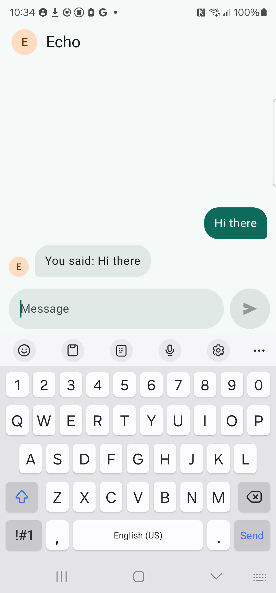
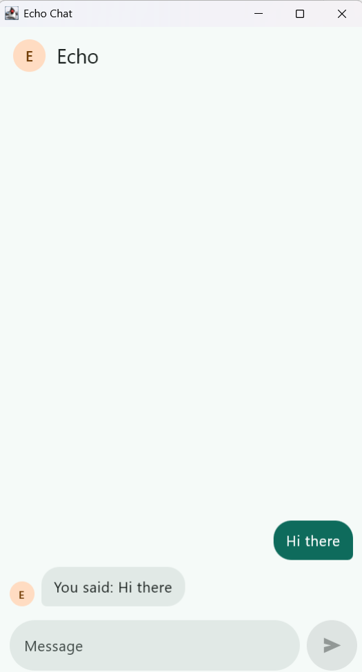
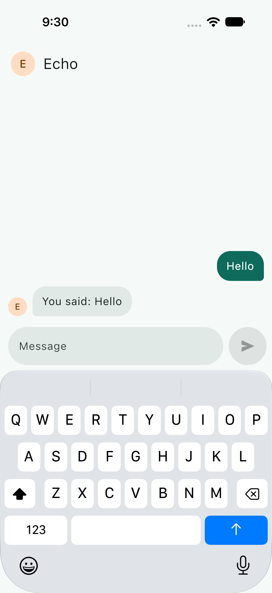
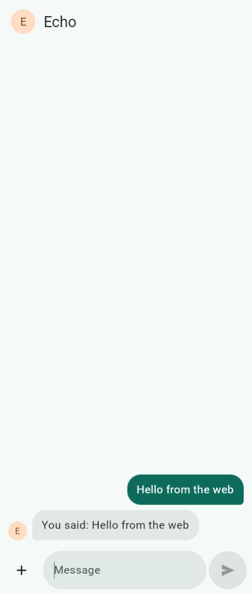
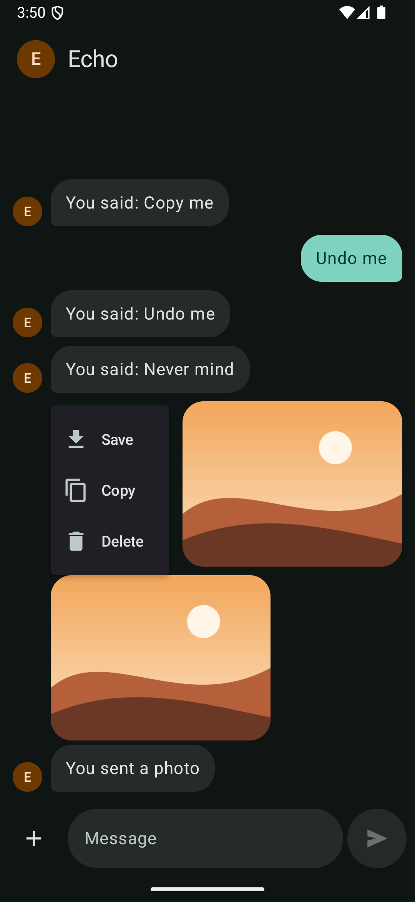
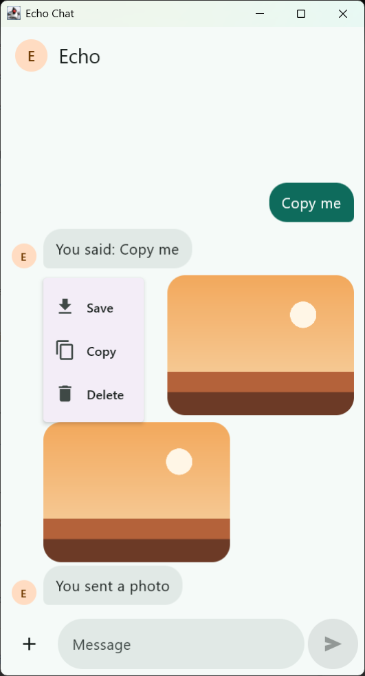
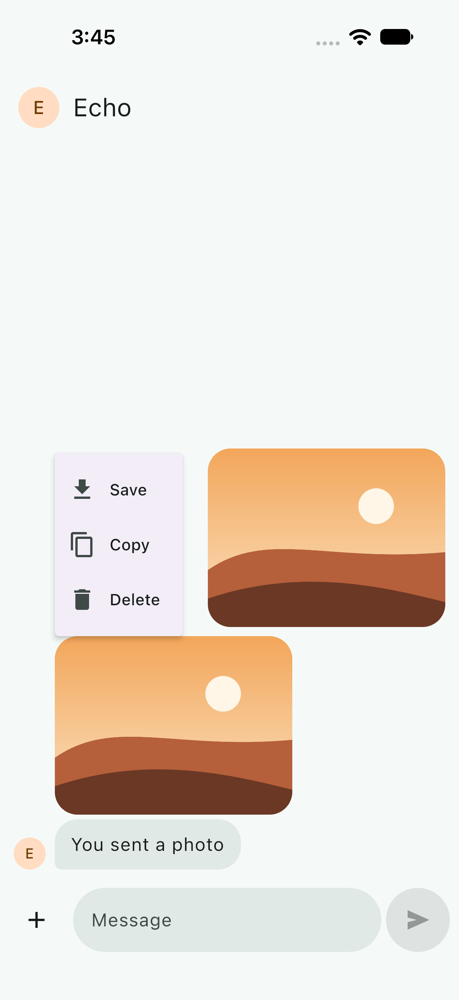
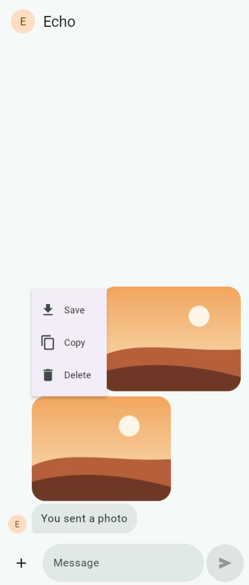

# Echo Chat, multiplatform

My Echo chat take-home, rebuilt in Kotlin Multiplatform so I can learn it. The original was an Android app: a chat with one contact, Echo, who repeats back everything you say after 5 seconds. This version runs the same shared code on Android, desktop, iOS and the web. [Try it in your browser](https://memorex386.github.io/echo-chat-kmp/).

The brief asked for two things: send a text message that appears on the right, and get a simulated reply on the left 5 seconds later. The original added photos, notifications, message actions and keyboard handling on top. Those come across here one slice at a time.

## Same chat, four platforms
| Android | Desktop | iOS | Web |
|:---:|:---:|:---:|:---:|
|  |  |  |  |
|  |  |  |  |

Top: a message and Echo's reply. Bottom: a photo's menu, opened with a long-press on the phones and a right-click on desktop and the web. The Android one is in dark theme.

## How much is shared
One Compose UI draws the whole chat on all four platforms, and the logic behind it is shared too. So most of the code is written once:

| Code | Lines | Share |
|---|---:|---:|
| Shared by all four | 1,163 | 67% |
| Web only | 168 | 10% |
| Android only | 141 | 8% |
| iOS only, including 23 lines of Swift | 119 | 7% |
| Desktop only | 101 | 6% |
| Android, iOS and desktop: the photo store | 24 | 1% |
| Desktop and the web: the keyboard, no camera | 14 | 1% |
| Android and iOS: the camera | 5 | under 1% |

Each app runs 88 to 92% shared code. The rest is what each system does its own way: notifications, the app's entry point, saving photos, the clipboard and the keyboard. Of the test code, 63% is shared, and each shared test runs on all four platforms.

Counted in November 2026, without blank lines, comments, imports or build files.

## Where it is
| Slice | Android | Desktop | iOS | Web |
|---|---|---|---|---|
| 1. Text chat: send, typing dots, echo after 5 s | ✅ | ✅ | ✅ | ✅ |
| 2. Photos: gallery and camera, photo echo, full-screen viewer | ✅ | ✅ Gallery only: no camera | ✅ Camera not checked: the simulator has none | ✅ Gallery only: no camera |
| 3. Polish: jump arrow, unsent work kept, landscape width, long text, photo captions, motion | ✅ | ✅ | ✅ Shared tests only | ✅ Shared tests only |
| 4. Notifications: a reply while away notifies, tapping it opens the chat | ✅ | ✅ Minimized not checked by hand | ✅ | ✅ The app's side; a real browser notification not checked by hand |
| 5. Message actions: copy, save, delete with Undo, from a long-press or right-click | ✅ | ✅ Save opens a Save dialog | ✅ | ✅ Save downloads the photo |
| 6. Keyboard: panel and keyboard take turns, Back closes the panel, rotation, landscape typing, Enter sends on desktop | ✅ | ✅ | ✅ Known issue after a rotation with the keyboard up (D33) | ✅ Esc or the browser's Back closes the panel |
| 7. Web: desktop browsers, a message for older ones, published to GitHub Pages | — | — | — | ✅ |

The criteria and their status are in [docs/spec.md](docs/spec.md), and the choices behind the build are in [docs/decisions.md](docs/decisions.md).

## Running it
- `./gradlew allTests` runs every shared test: on the JVM and in headless Chrome on Windows, and on the iOS simulator on a Mac. No emulator needed, but the browser tests need Chrome installed.
- `./gradlew :androidApp:connectedDebugAndroidTest` runs the Android device tests on a running emulator or phone.
- `./gradlew :androidApp:installDebug` installs the Android app. It runs on Android 8.0 and later.
- `./gradlew :desktopApp:run` runs the desktop app.
- `./gradlew :webApp:wasmJsBrowserDevelopmentRun` runs the web app in your browser.
- iOS, on a Mac: open `iosApp/iosApp.xcodeproj` in Xcode and run the `iosApp` scheme. Xcode builds the shared code through Gradle, so the Mac needs JDK 21 too. Test runs the iOS end-to-end tests, which need the simulator's on-screen keyboard to stay up (D32).

Built with JDK 21, Android SDK 37, Xcode 27, Kotlin 2.4.21 and Compose Multiplatform 1.12.2.

## Ambiguities
Carried over from the original:
- **What the reply says.** Echo repeats the message: "You said: Hello". A photo comes back with its caption, or with "You sent a photo".
- **Messages sent close together.** Each message gets its own reply, 5 seconds after that message. You can keep sending while replies are on their way.
- **"Beneath the previous message".** Replies are added to the bottom in the order they arrive. If I send two messages quickly, both come before both replies.
- **Empty messages.** Send stays disabled until there is text or a photo, and spaces around a message are dropped.
- **Persistence.** In memory, as the brief allows, so messages are gone when the app ends. Unsent work is kept while the app runs, and on Android also after Android ends the app in the background.

New in this version:
- **Platforms.** Android, desktop (on the JVM, checked on Windows), iOS and desktop browsers, from one Kotlin codebase with Compose Multiplatform. Phone browsers aren't supported: phones have the apps. In a browser, Save downloads the photo, and reloading the page starts afresh, as quitting does elsewhere.
