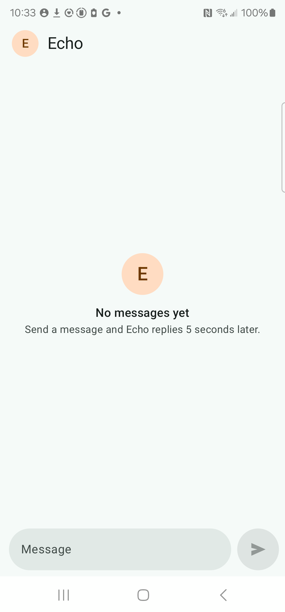
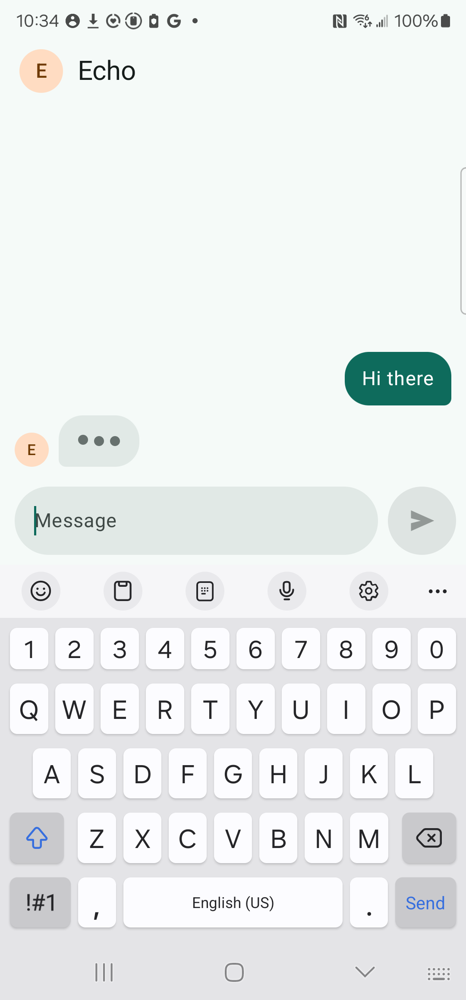
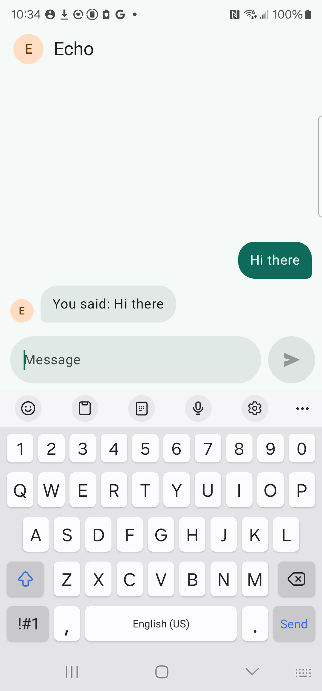
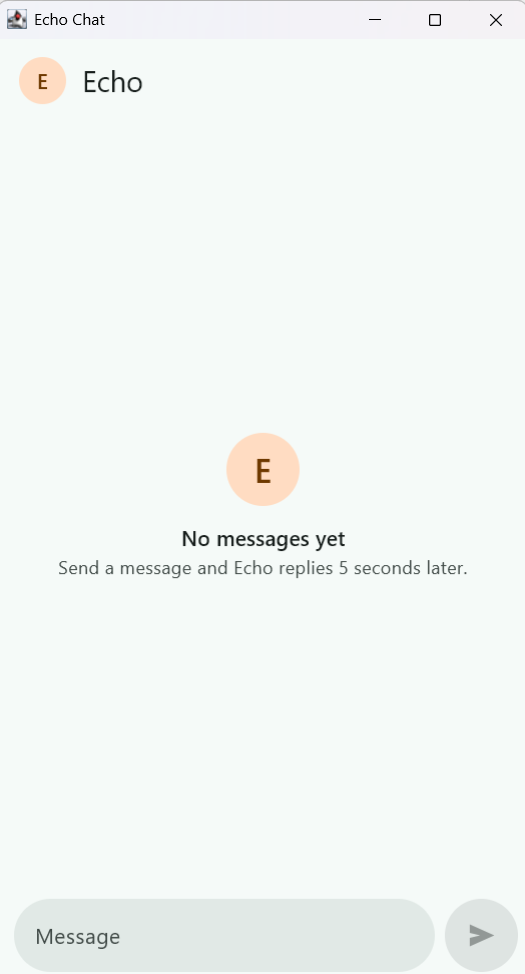
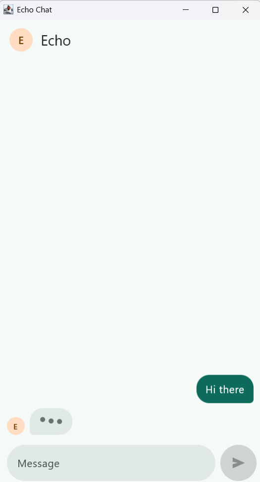
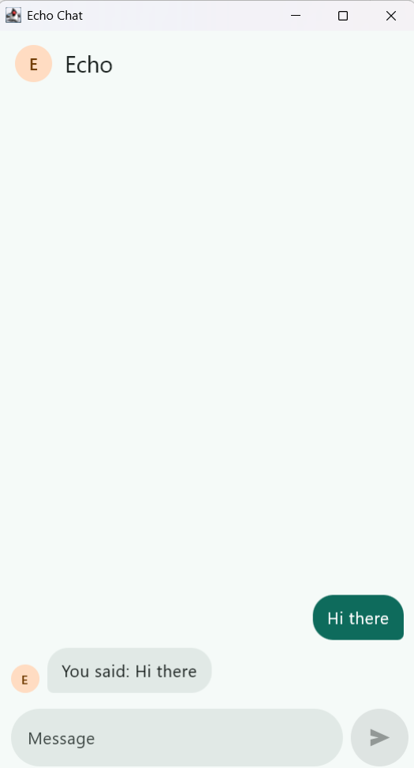
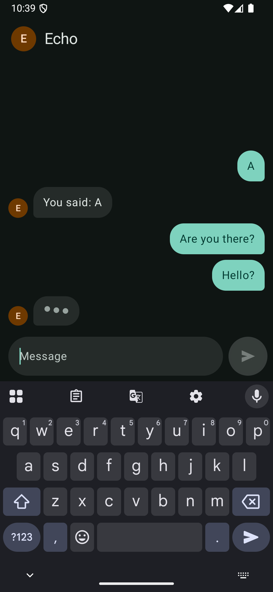
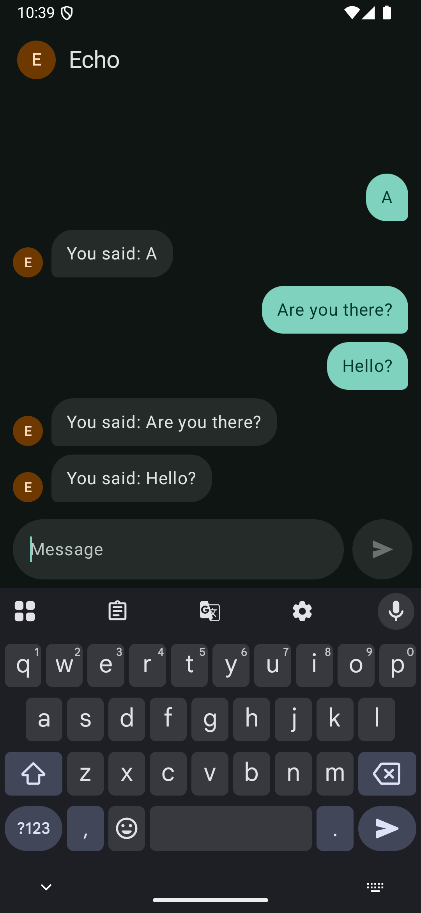

# Checkpoint 1: text chat

**Goal:** the brief, plus the typing dots and Echo's avatar, from shared code on Android and desktop. CHAT-01 to CHAT-13 pass. The shared code compiles for iOS.

**Date:** 2026-11-03 · **Branch:** `main`

## What changed
| Where | Change |
|---|---|
| `build-logic` | Convention plugins for multiplatform libraries, Compose libraries, features, and the Android and desktop apps. |
| `core:model`, `core:database`, `core:network`, `core:data` | Ported to `commonMain` almost unchanged. The id counter uses Kotlin's own `AtomicLong`, and Hilt's modules became Koin modules. |
| `core:designsystem` | Theme, `Avatar` and `TypingDots` unchanged. The send icon moved to Compose resources. |
| `feature:chat` | `ChatViewModel` and `ChatScreen` unchanged apart from Koin and Compose resources. The navigation key is registered for saving, because iOS can't find it by reflection. |
| `shared` | `EchoChatApp()`, the Koin start-up, and `MainViewController()` for iOS. |
| `androidApp`, `desktopApp` | Each starts Koin and shows `EchoChatApp()`. |

## Tests
### `./gradlew allTests`: 17 of 17 pass, on the JVM
| Module | Tests | Before the code |
|---|---|---|
| `core:data` | `ChatRepositoryTest`: CHAT-01 ×2, CHAT-04, CHAT-05, CHAT-10, CHAT-12, CHAT-13 | All 7 failed with `NotImplementedError` |
| `feature:chat` | `ChatViewModelTest`: CHAT-02, CHAT-03 | Both failed with `NotImplementedError` |
| `feature:chat` | `ChatScreenTest`: CHAT-02 ×2, CHAT-06, CHAT-07, CHAT-09, CHAT-10, CHAT-11 | All 7 failed: the stub screen drew nothing, so each node was missing |
| `shared` | `AppModulesTest`: the Koin wiring | Written with the wiring. With the database and network modules taken out, it fails with `InstanceCreationException`. |

The iOS simulator tests are skipped on Windows; they need a Mac.

### iOS compile: passes
`./gradlew compileKotlinIosArm64 compileKotlinIosSimulatorArm64 compileTestKotlinIosSimulatorArm64` compiles every module and its tests for iOS on Windows. The first attempt failed on a comma in a test name, which Kotlin/Native doesn't allow (D7).

### `./gradlew :androidApp:connectedDebugAndroidTest` on the Galaxy S23: 2 of 2 pass
| Test | Time | What it shows |
|---|---|---|
| `sendingHelloShowsTypingDotsThenTheEcho` | 6.1 s | Typed "Hello", sent it, saw the dots, then "You said: Hello" after the real 5-second wait |
| `CHAT-08_messagesAndUnsentTextSurviveARotation` | 2.0 s | After the activity was rebuilt, the sent message and the unsent draft were still there |

Both were written after the code, so they weren't seen failing first.

## On devices
| State | Screenshot | What it shows |
|---|---|---|
| S-01 Empty, Android |  | Galaxy S23, Android 14. Echo's avatar and name, the 5-second hint, Send disabled. |
| S-03 Echo is typing, Android |  | My message on the right, the input cleared, Echo's avatar and the dots on the left |
| S-04 Replied, Android |  | "You said: Hi there" 5 s later, and the dots gone |
| S-01 Empty, desktop |  | Windows 11, the same screen in a 420 × 760 dp window |
| S-03 Echo is typing, desktop |  | The same shared screen and dots |
| S-04 Replied, desktop |  | The echo, 5 s later |
| S-05 Quick sends, dark |  | `darkmode35` emulator, Android 15. Two messages waiting and one set of dots. |
| S-05 answered, dark |  | The replies in order, in the dark palette |

The keyboard's own Send key sends too, on Android.

## Not verified here
- **iOS.** The Mac wasn't reachable over SSH, so the app hasn't been linked or run on iOS, and the iOS tests haven't run. Agreed in review: the Xcode project is written and run on the Mac once it is reachable. Done the next day, in [01b-text-chat-ios.md](01b-text-chat-ios.md).
- **Enter on desktop.** It starts a new line rather than sending, because the input allows 4 lines. In review this became KEY-05, for the keyboard slice (D11).
- **The emoji round trip (CHAT-13)** on a device: checked by the shared test only.
