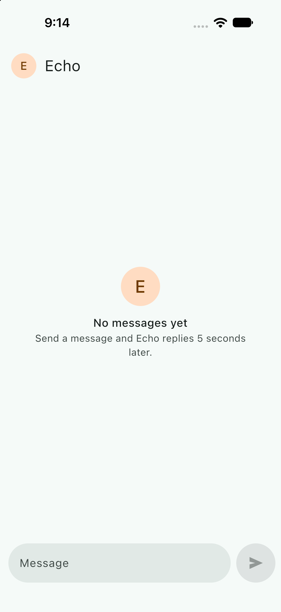
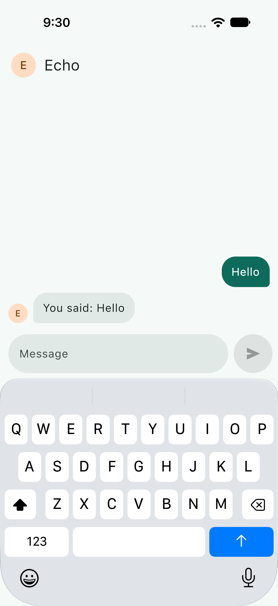

# Checkpoint 1b: text chat on iOS

**Goal:** the slice 1 chat runs on iOS from the same shared code, and its tests pass on the iOS simulator.

**Date:** 2026-11-04 · **Branch:** `main`

## What changed
| Where | Change |
|---|---|
| `iosApp` | The Xcode project: `iOSApp.swift` starts Koin, `ContentView.swift` shows `MainViewController()`, and a build phase builds the `Shared` framework through Gradle. |
| `iosApp/iosAppUITests` | `ChatEndToEndUITests`, the iOS end-to-end test, and a shared `iosApp` scheme that runs it. |
| The Mac | JDK 21.0.13 (Temurin) in `~/Library/Java/JavaVirtualMachines`, the project copied to `~/code/echo-chat-kmp`, and a new simulator, "Echo Chat iPhone 18 Pro". |

No Kotlin changed.

## Tests on the Mac
macOS 27.0.1, Xcode 27.0, Apple silicon.

### `./gradlew allTests`: 17 of 17 pass on the iOS simulator, and 17 of 17 on the JVM
The same tests as on Windows. This is the first run of the shared UI tests on iOS: `ChatScreenTest` passes there too.

### `xcodebuild test`: 1 of 1 passes
`ChatEndToEndUITests.testSendingHelloShowsTypingDotsThenTheEcho` passed in 14.3 s on "Echo Chat iPhone 18 Pro", iOS 27.0, with the real 5-second wait. It needed two fixes on the way:
- **No text field.** iOS sees the 4-line input as a text view, so the test asked for one that didn't exist. It now asks for the text view labelled "Message".
- **Two Send buttons.** The keyboard's return key is labelled Send as well. The test now sends with the keyboard's key.

## On the simulator
| State | Screenshot | What it shows |
|---|---|---|
| S-01 Empty |  | The same empty state, laid out around the Dynamic Island and the home indicator |
| S-03 Echo is typing |  | Taken by the UI test: "Hello" sent, the dots on the left, the input above the keyboard |
| S-04 Replied |  | Taken by the UI test: "You said: Hello" 5 s later |

## Not verified here
- **A real iPhone.** Only the simulator. A phone needs a signing team set in Xcode.
- **Dark theme on iOS.** Not checked; the palette is shared code, checked on Android.
