# Checkpoint 2: photos

**Goal:** attach a photo from the gallery or the camera, send it with an optional caption, get it echoed back, and open any photo full screen, on Android, desktop and iOS. PHOTO-01 to PHOTO-05 pass.

**Date:** 2026-11-04 · **Branch:** `main`

## What changed
| Where | Change |
|---|---|
| `core:model`, `core:database` | `Image`, with the path of the app's own copy, and a message's optional image. |
| `core:network` | The echo carries the photo, with "You said: …" or "You sent a photo". |
| `core:data` | `ImageStore` and `CacheImageStore`: a picked photo is copied into the cache's `images` folder, and the camera gets a new file there to save into (D14). |
| `feature:chat` | The attach panel, the preview with its remove button, photo bubbles with the caption underneath, and `PhotoViewerScreen`. The gallery uses FileKit's picker; the camera is an `expect` in `commonMain` with `actual`s in `mobileMain` and `jvmMain` (D15). |
| `shared` | The `PhotoKey` screen on the back stack, and Coil set up with FileKit's file support. |
| `desktopApp` | `FileKit.init(appId = "EchoChat")`, which names the app's folders. |
| `iosApp` | The camera's usage text, and a second UI test for picking, sending and viewing a photo. |
| `androidApp` | The device test uses the `v2` Compose test rule, which replaced the deprecated one. |

## Tests
### `./gradlew allTests`: 29 of 29 pass, on the JVM and on the iOS simulator
| Module | New tests | Before the code |
|---|---|---|
| `core:data` | PHOTO-03 | Failed: the message had no image |
| `core:network` | PHOTO-04 ×2 | Failed: the reply had no image, and the uncaptioned echo said "You said: " |
| `feature:chat` (ViewModel) | PHOTO-01 ×2, PHOTO-02, PHOTO-03 | Failed with `NotImplementedError` |
| `feature:chat` (screen) | PHOTO-01 ×3, PHOTO-02 | Failed: no Attach button or remove button |
| `shared` | PHOTO-05 | Failed with `NotImplementedError` from the attachment stub |

Two things came up on the way:
- **PHOTO-05 failed on iOS only:** FileKit's picker needs a UIKit view controller, and the test had none. `AppTestHost` gives the iOS test one (D16).
- **Android had no camera `actual`:** `withAndroidTarget()` doesn't match AGP 9's Android library target, so `mobileMain` picks Android by platform type (D15).

### Android device tests on the S23 and the emulator: 2 of 2 pass
The end-to-end check and CHAT-08, now on the `v2` test rule.

### iOS UI tests on the simulator: 2 of 2 pass
`testSendingHelloShowsTypingDotsThenTheEcho`, and `testAPhotoFromTheGalleryIsSentEchoedAndOpenedFullScreen` (18.9 s). The photo test picks the newest photo in the simulator's library, sends it without a caption, waits for "You sent a photo", opens Echo's photo and comes back.

## Android
`darkmode35` emulator, Android 15, dark theme. Not the S23, so that the photo picker shows test pictures, not personal ones. The emulator's gallery had a sunset picture.

| Step | Screenshot | What it shows |
|---|---|---|
| Attach panel | 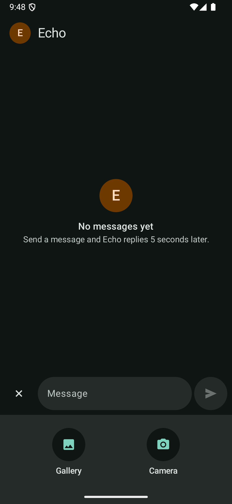 | **+** turned into ✕, with Gallery and Camera |
| Photo picker | 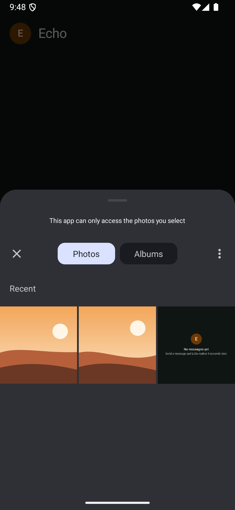 | Android's own picker: "This app can only access the photos you select" |
| S-09 Photo attached | 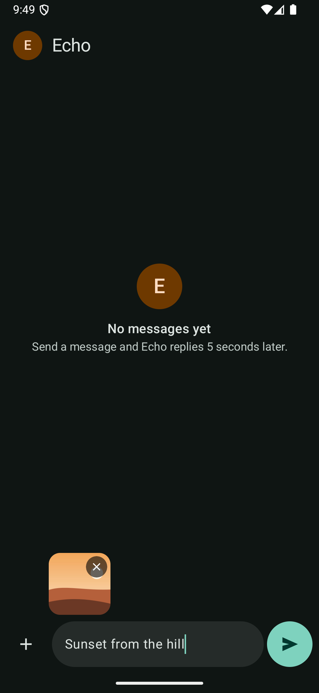 | The preview with its remove button and the caption typed |
| S-10 Photos | 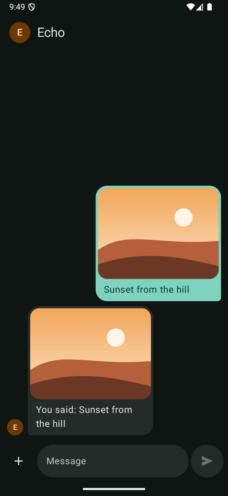 | The photo and caption, and Echo's echo of both |
| S-11 Viewer | 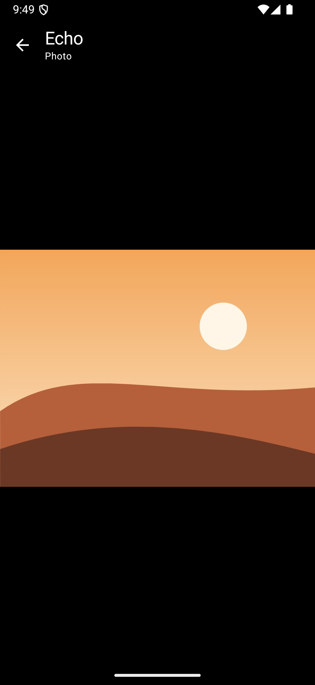 | Fitted on black, "Echo · Photo", light status-bar icons. Back returned to the chat. |
| Camera | 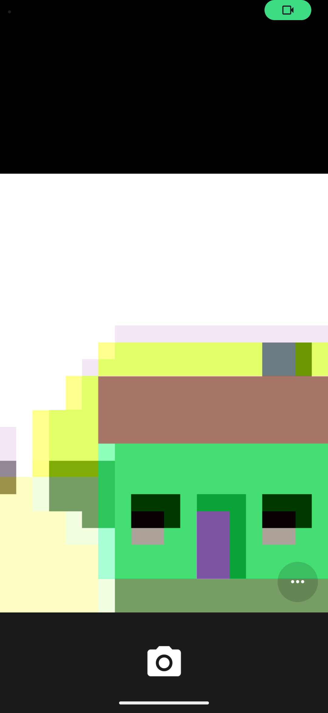 | The emulator's own camera app, opened by the app |
| Camera echo | 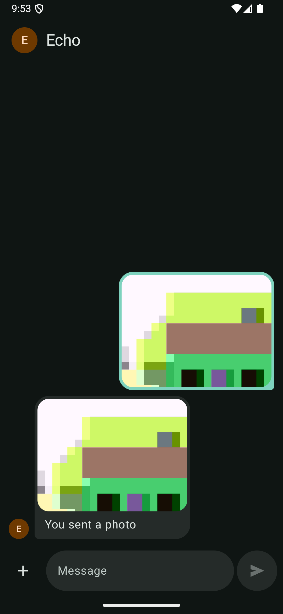 | Sent with no caption: "You sent a photo" |

In `run-as com.echochat.kmp ls cache/images`, the picked photo's copy has the same MD5 as the gallery's `sunset.jpg`, 33,888 bytes, with mode `-rw-------`. The camera's shot was saved straight into `cache/images`, with no copy elsewhere.

## Desktop
Windows 11. The file dialog is Windows' own Open dialog, filtered to `*.png;*.jpg;*.jpeg;*.gif;*.bmp`. It isn't pictured, because it opened on my Documents folder.

| Step | Screenshot | What it shows |
|---|---|---|
| Attach panel | 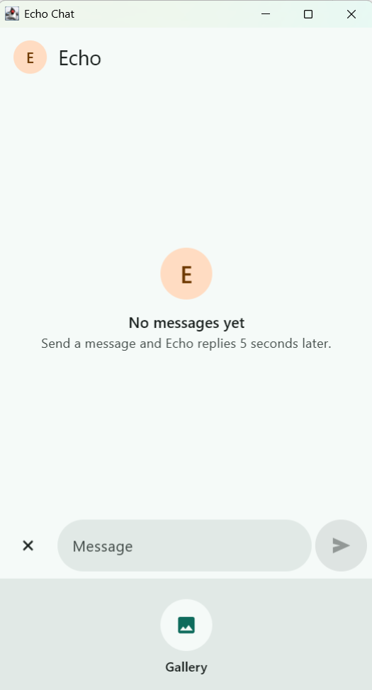 | Gallery only: desktop has no camera |
| Photo attached | 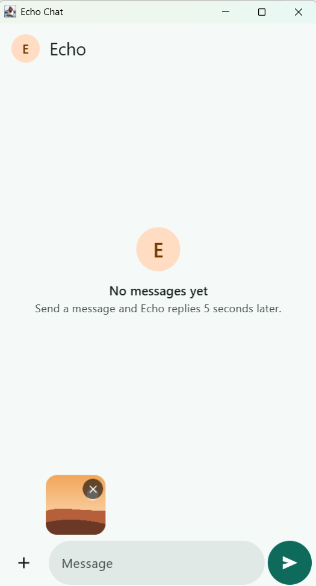 | The picked sunset as a preview, Send enabled with no text |
| Echo | 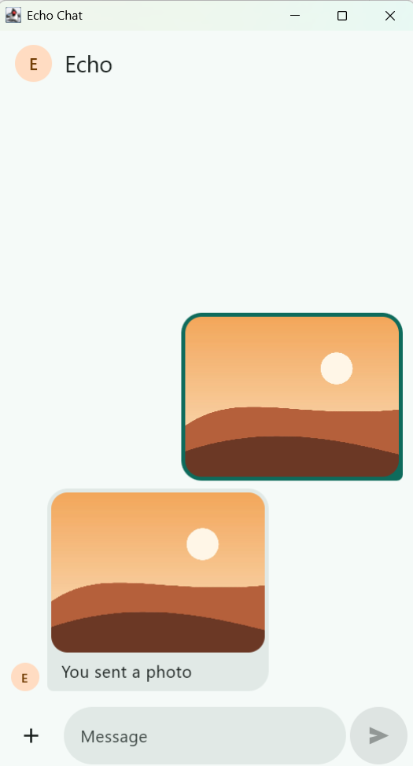 | "You sent a photo" with the same photo |
| Viewer | 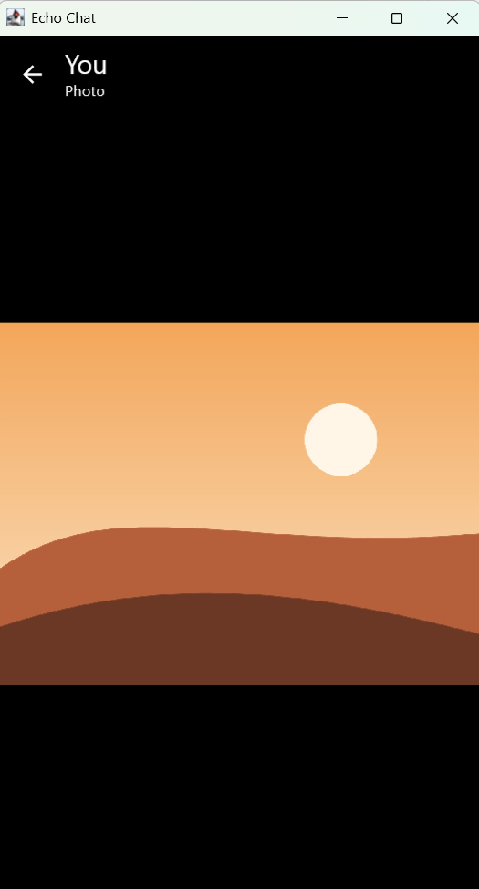 | "You · Photo" on black; the back arrow returned to the chat |

The copy in `%LOCALAPPDATA%\EchoChat\Cache\images` is 32,681 bytes, the size of the picked file.

## iOS
"Echo Chat iPhone 18 Pro" simulator, iOS 27. Screenshots taken by the UI test.

| Step | Screenshot | What it shows |
|---|---|---|
| Photo attached | 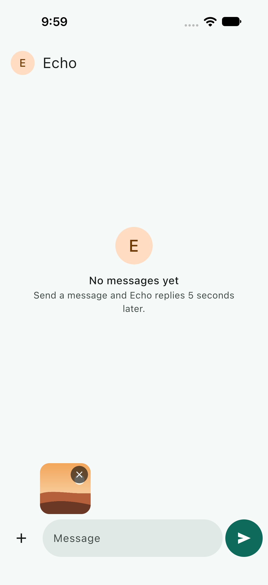 | Picked with iOS's own photo picker ("Private Access to Photos") |
| Echo | 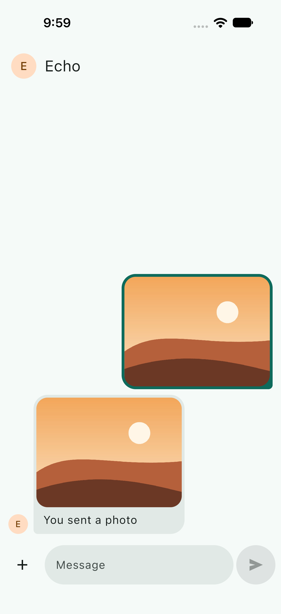 | "You sent a photo" with the same photo |
| Viewer | 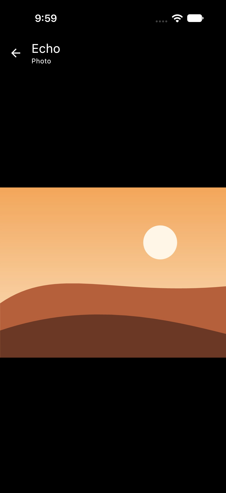 | Fitted on black. The status-bar icons turned light by themselves. |

## Not verified here
- **The camera on iOS.** The simulator has no camera. It needs a real iPhone, which needs a signing team in Xcode.
- **Captions on iOS and desktop.** Those checks sent photos without one; the captioned path was checked on Android and by the shared tests.
- **A phone with no camera app.** FileKit reports it as nothing saved, so nothing is attached. Read, not run.
- **Very large photos.** Copied whole, as in the original.
