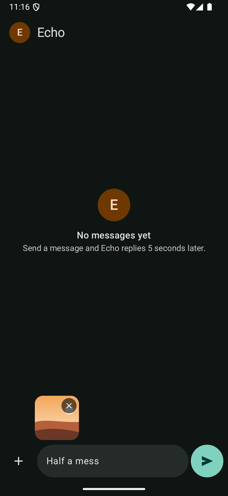
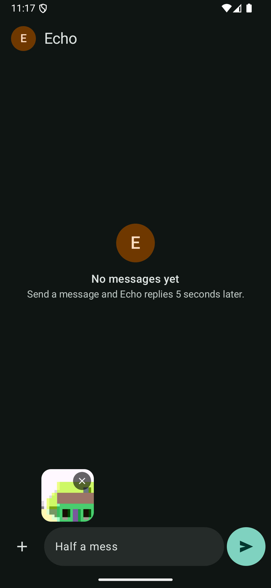
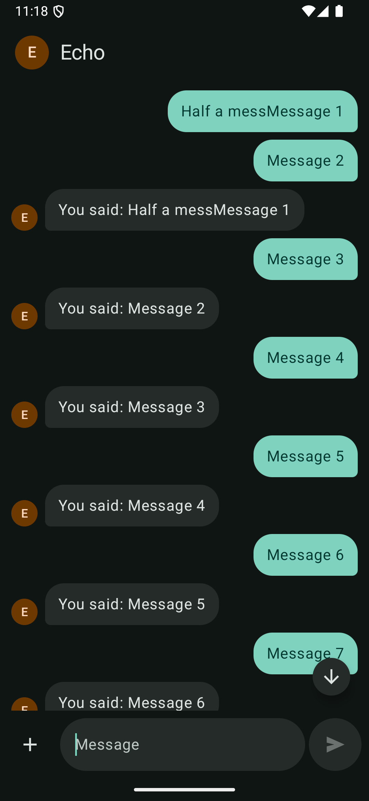
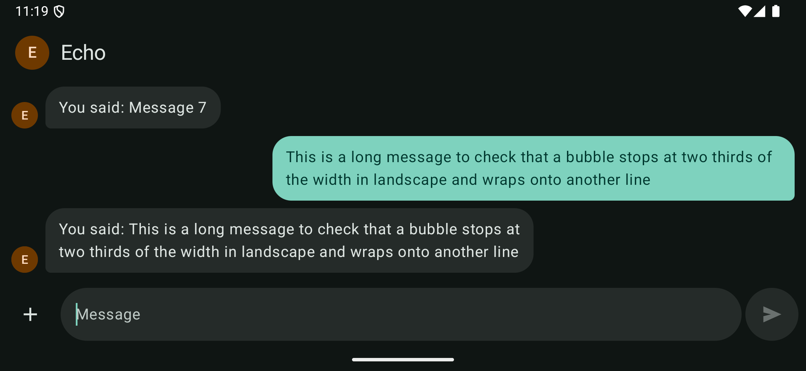
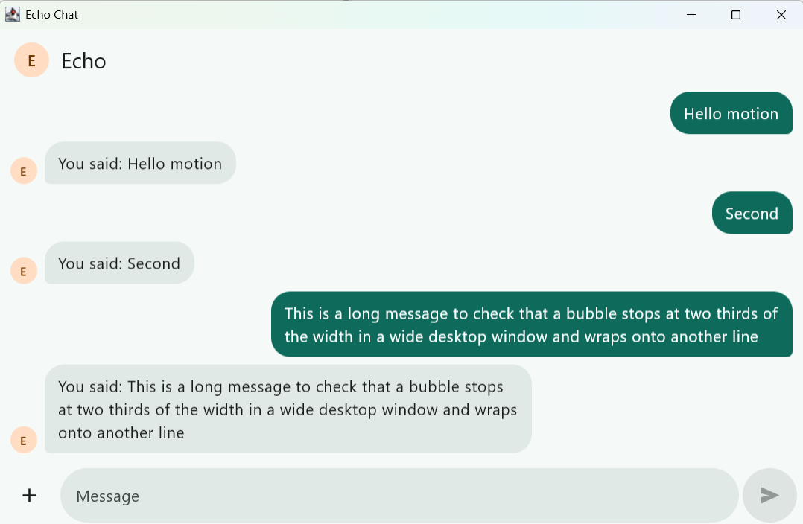
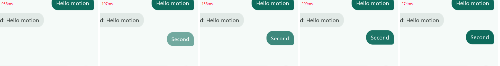

# Checkpoint 3: polish

**Goal:** the original's polish, from shared code: a jump-to-latest arrow, unsent work that survives rotation and leaving the app (and, on Android, Android ending the app), two-thirds width in landscape, long messages that behave, photos standing apart from their captions, and the motion. CHAT-14 to CHAT-18 and PHOTO-06 pass.

**Date:** 2026-11-04 · **Branch:** `main`

## What changed
| Where | Change |
|---|---|
| `feature:chat` · `ChatViewModel` | The draft, the attached photo and a camera shot in progress go into `SavedStateHandle` as they change (D19). |
| `feature:chat` · message list | Follows new messages only from the bottom or when they are mine, with a jump arrow otherwise; keeps the end of a tall message in view when the list gets shorter; saves its place across a rotation (D18). |
| `feature:chat` · layout and motion | Landscape from the chat's own shape (D20). Photos apart from their caption bubbles. New bubbles fade, rise and grow from their own corner. |
| `shared` | Coil's crossfade, so photos fade in. |
| `androidApp` | The CHAT-08 device test rotates the activity to landscape and back. |

## Tests
### `./gradlew allTests`: 42 of 42 pass, on the JVM and on the iOS simulator
13 new tests: CHAT-14 ×3, CHAT-15 ×4, CHAT-16, CHAT-17 ×2, CHAT-18 ×2 and PHOTO-06.

Before the code:
- **Failed for the expected reason:** CHAT-14 (no jump arrow, and the place not kept after a rotation), CHAT-15 ×3 (nothing saved), CHAT-16 (a bubble 496 dp wide in a 640 dp-wide landscape screen), CHAT-18 ×2 (the newest message out of view), PHOTO-06 (the photo inside a bubble).
- **Passed from the start,** as in the original, because the behaviour already existed: CHAT-14 "sending my own message scrolls to it", CHAT-17 ×2, and CHAT-15 "nothing is restored once the message is sent".
- **Three test problems were fixed on the way** (D21): the rotation tests first hit Compose's unimplemented `StateRestorationTester` on desktop, my first replacement didn't restore anything, and one CHAT-18 check passed when it shouldn't have until it used unclipped bounds.

### Android device tests on the emulator: 2 of 2 pass
CHAT-08 now rotates the activity to landscape and back for real, and the message and "Half a mess" survive both rebuilds.

### iOS UI tests on the simulator: 2 of 2 pass

## Android
`darkmode35` emulator, Android 15, dark theme.

| | Screenshot | What it shows |
|---|---|---|
| CHAT-15 |  | "Half a mess" typed and a photo attached, then Home, then the app's process killed (PID 4101 gone, cold start as PID 4561). Both came back. |
| CHAT-15, camera |  | The app's process killed while the camera app was open. After Done, the app restarted (PID 4920) and the shot was attached. |
| CHAT-14 |  | Scrolled up while replies arrived: the list stayed put and the arrow showed. Tapping it went to the newest reply. |
| CHAT-16, CHAT-18 |  | Rotated with the emulator's own rotate. The newest messages stayed in view with no arrow. The long message's text is 1,438 px wide, inside two thirds of 2,340 px. |

A screen recording of a send, the reply and the jump arrow was taken at normal speed. It isn't committed, because the repo's rule allows screenshots but not video.

## Desktop
Windows 11.

| | Screenshot | What it shows |
|---|---|---|
| CHAT-16 |  | A window wider than tall counts as landscape: the long message's bubble is about 700 px wide in a 1,084 px window. |
| Motion |  | Frames captured about every 16 ms after sending "Second". The bubble fades in, at about half opacity at 107 ms and full by 274 ms, while rising a few pixels. |

## Not verified here
- **Motion at slow speed, and with animations off.** The emulator's animation scale wasn't changed, since it is a system setting. On desktop the entrance was caught frame by frame instead.
- **iOS by hand.** iOS ran all 42 shared tests, including the 20 screen tests, but wasn't rotated or scrolled by hand.
- **The keyboard opening on a long chat on a phone.** It goes through the same "the list got shorter" code as the growing input and the rotation, which CHAT-18's tests cover.
