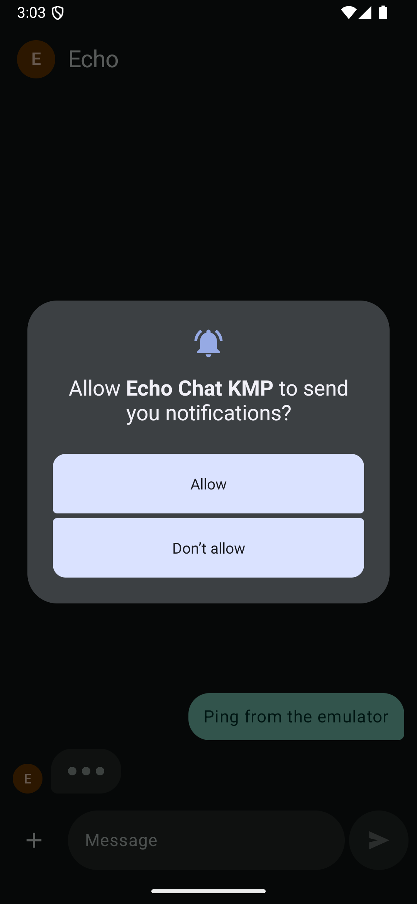
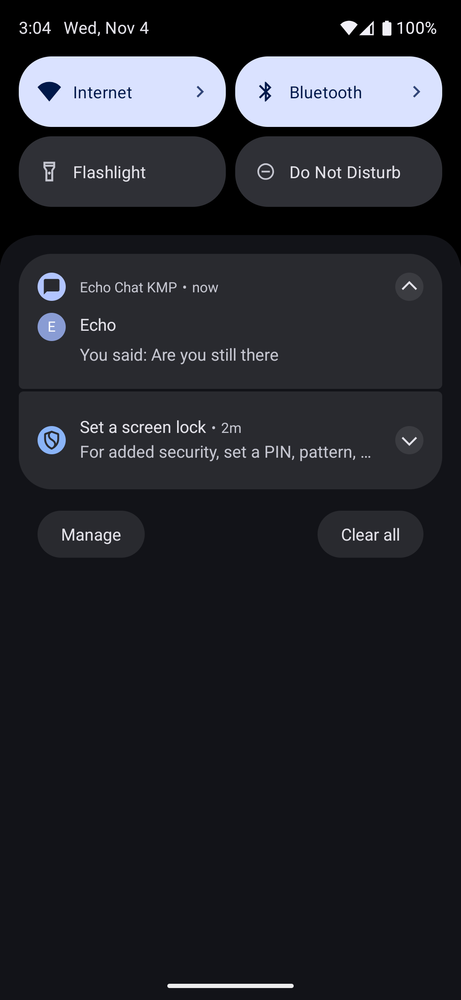
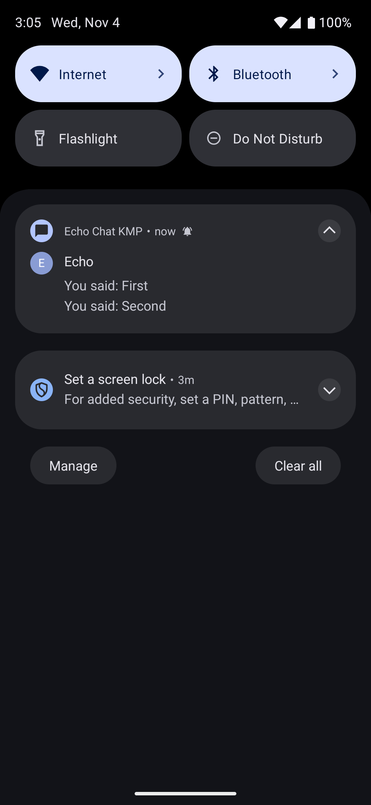
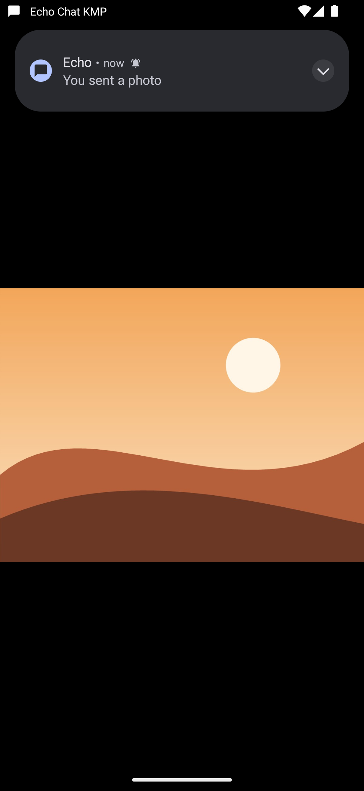
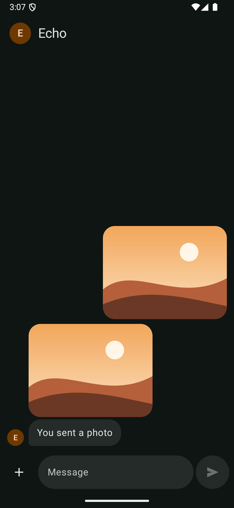
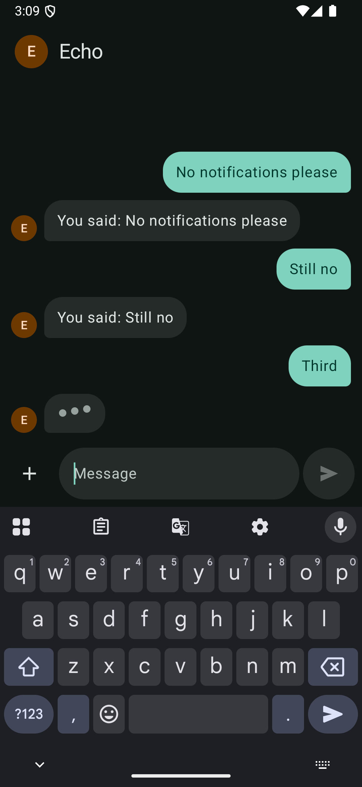
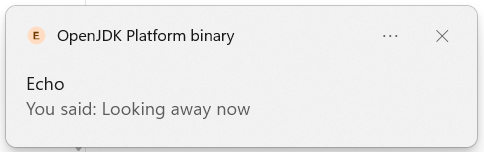
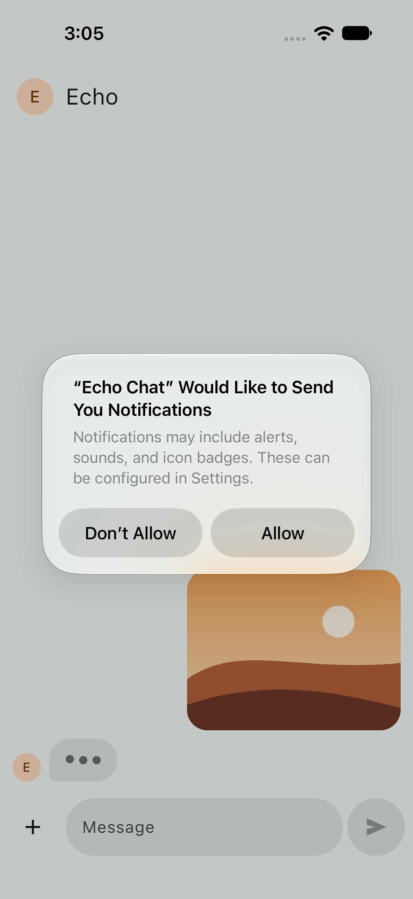
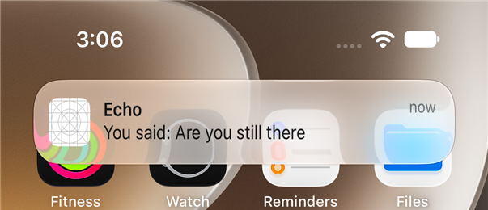
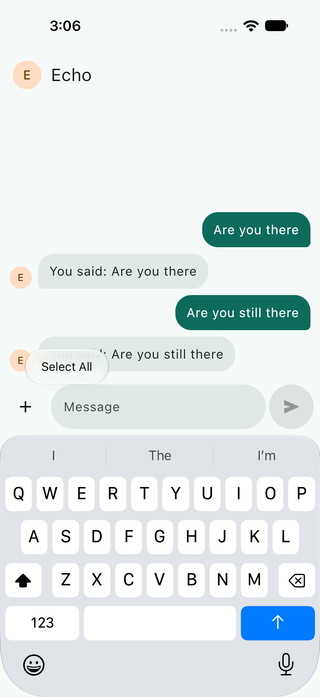

# Checkpoint 4: notifications

**Goal:** Echo's replies notify when the chat isn't on screen, on every platform, with the rules in shared code and only the posting per platform. Tapping a notification opens the chat. NOTIFY-01 to NOTIFY-05 pass.

**Date:** 2026-11-04 · **Branch:** `main`

## What changed
| Where | Change |
|---|---|
| `core:notifications` (new) | `Notifier` and the shared `ChatNotifier`, which decides what to show (D22). A `NotificationTray` for each platform: Android's conversation notification ported from the original, iOS's notification centre, and a Windows tray icon. `ChatRequests`, the shared "open the chat" signal (D24). |
| `core:data` | `ChatRepository` hands every reply to the notifier, as before. `MessageDao.insertReply` returns the reply's id, so the notifier gets the stored message. |
| `feature:chat` | The chat screen tells the notifier when it is shown and hidden (D23), and asks for permission on the first send. |
| `shared` | `EchoChatApp` closes anything above the chat when the chat is asked for. `initKoin` takes each platform's own set-up. |
| `androidApp` | `MainActivity` turns the notification's intent into a request. The device test grants the permission first. |
| `desktopApp` | Clicking a notification restores and focuses the window. |
| `iosApp` | The app installs the notification centre's delegate as it starts. The UI tests allow notifications, and a new one goes Home, waits for the banner and taps it. |

## Tests
### `./gradlew allTests`: 60 of 60 pass on Windows, 50 of 50 on the iOS simulator
- **On Windows:** 50 shared tests on the JVM, and 10 Android local tests in `core:notifications`: `AndroidNotificationTrayTest` and the shared `ChatNotifierTest` again, under Robolectric (D25).
- **New tests:** 18 in all. `ChatNotifierTest` ×5, run on the JVM, on Android and on iOS. NOTIFY-01 in `ChatRepositoryTest`. NOTIFY-02 and NOTIFY-04 in `ChatNavigationTest`. `AndroidNotificationTrayTest` ×5.
- **Before the code:** the 18 failed for the expected reason, while the 42 existing tests passed. For example, NOTIFY-01 "every reply is handed to the notifier" got an empty list, and the whole-app NOTIFY-02 test found the notifier never told the chat was on screen.

### Android device tests on the S23 (Android 14): 2 of 2 pass
The end-to-end test grants the notification permission before it starts, so the first send doesn't stop for the prompt.

### iOS UI tests on the simulator: 3 of 3 pass
`testAReplyWhileAwayNotifiesAndTappingItOpensTheChat` is new. Each run was from a fresh install, so iOS asked for permission. Three runs: the Hello test alone, the notification test alone, and all three together.

The first full run failed the Hello test, a test-timing problem rather than an app one. Looking for the permission prompt after every send took long enough for the typing dots to finish before they were checked. Now each test looks for the prompt only where the wait can't hide anything. The notification test sends twice, so the reply it waits for never races the prompt.

## Android
`darkmode35` emulator, Android 15, dark theme, from a fresh install.

| | Screenshot | What it shows |
|---|---|---|
| NOTIFY-05 |  | The first send asks, with the typing dots already showing behind. |
| NOTIFY-01 |  | Sent, then Home before the reply. Echo's reply is in the shade as a conversation from Echo. |
| NOTIFY-03 |  | Two sent, then Home. One notification, both replies, oldest first. `dumpsys notification` shows one record, id 1. |
| NOTIFY-01, viewer |  | A photo sent and opened full screen. Echo's reply arrives as a heads-up over the viewer. |
| NOTIFY-04 |  | Tapping the heads-up closed the viewer and showed the chat. No notification from Echo is left. |
| NOTIFY-05, refused |  | A fresh install, "Don't allow" tapped. Replies still arrive in the chat; one sent before going Home posted nothing; the next send didn't ask again. |

Also checked:
- **Tapping the shade's notification** from the home screen opened the chat and cleared it (NOTIFY-02, NOTIFY-04).
- **Opening the app from the launcher** cleared the waiting notification too (NOTIFY-02).

## Desktop
Windows 11, run with `./gradlew :desktopApp:run`.

| | Screenshot | What it shows |
|---|---|---|
| NOTIFY-01 |  | Sent, then the focus moved to the taskbar, leaving the window visible. Echo's reply arrives as a Windows notification. Windows names the sender after the Java runtime (D24). |

Also checked:
- **Focused window (NOTIFY-02):** no notification when one would have shown.
- **Clicking the notification (NOTIFY-04):** the unfocused window came back into focus.

## iOS
"Echo Chat iPhone 18 Pro" simulator, screenshots from `testAReplyWhileAwayNotifiesAndTappingItOpensTheChat` and the photo test.

| | Screenshot | What it shows |
|---|---|---|
| NOTIFY-05 |  | The first send asks. The test taps Allow. |
| NOTIFY-01 |  | Home before the reply. Echo's reply shows as a banner. |
| NOTIFY-04 |  | Tapping the banner brings the app back on the chat. |

## Not verified here
- **Desktop, minimized.** The Claude app's own notifications, waiting on me in other sessions, held Windows' notification spot throughout, so Echo's queued behind them. Being away goes through the same lifecycle signal as an unfocused window, which was checked. Restoring a minimized window on click wasn't.
- **Windows listing each reply (NOTIFY-03).** Not looked at in Windows' notification centre.
- **iOS stacking (NOTIFY-03) and iOS over the photo viewer.** The iOS test has one reply and goes Home. The thread that stacks replies and the banner over an open app are set up but weren't seen.
- **Refusing on iOS.** Only allowing is tested there.
