# Checkpoint 5: message actions

**Goal:** the original's message actions on every platform. A long-press, or a right-click, opens a menu at the bubble: Copy and Delete for text, and Save, Copy and Delete for a photo. Delete offers Undo, and a reply already on its way still arrives. ACTION-01 to ACTION-06 pass.

**Date:** 2026-11-04 · **Branch:** `main`

## What changed
| Where | Change |
|---|---|
| `core:database` | A message can be marked as deleted, so Undo brings it back in the same place (D26). |
| `core:data` | `ChatRepository.delete` and `undoDelete`. `ImageStore` saves a copy to the phone's photos, or where a Save dialog chose (D28). Cached photos keep a real file extension (D27). |
| `feature:chat` | The menu at the bubble, opened by a long-press or a right-click. The Undo, "Copied" and save snackbars. Copy and Save done each platform's way (D27, D28). A `FileProvider` for the photo's content link on Android. |
| `core:testing` | `TestClipboard`, and fakes that record deletes and saves (D29). |
| `iosApp` | The reason iOS shows when asking to add to Photos. The UI tests also delete and undo, and save Echo's photo. |

## Tests
### `./gradlew allTests`: 76 of 76 pass on Windows, 66 of 66 on the iOS simulator
- **On Windows:** 66 shared tests on the JVM, and the 10 Android local tests from slice 4.
- **New tests:** 16 on each platform:
  - `ChatRepositoryTest` ×2 (ACTION-05, ACTION-06)
  - `ChatViewModelTest` ×3 (ACTION-04 ×2, ACTION-05)
  - `ChatScreenTest` ×7 (ACTION-01 ×4, ACTION-02, ACTION-04, and one for each photo item)
  - `MessageActionsTest` ×3 (ACTION-02, ACTION-05 ×2), the whole app with the real repository
  - `PhotoClipTest` (ACTION-03), one for desktop and one for iOS
- **Before the code:** the 16 failed for the expected reason, while the 60 existing tests passed. There was no menu to find, nothing was hidden, no snackbar events came, and nothing was copied.

### Android device tests on the S23 (Android 14): 3 of 3 pass
`aCopiedPhotoIsSharedAsAContentLinkOtherAppsCanOpen` is new. It reads a photo back through the real `FileProvider`, as `image/jpeg`. Against the stub it failed for the expected reason: a `file:` link instead of a `content:` one.

### iOS UI tests on the simulator: 3 of 3 pass, from a fresh install
The Hello test now also long-presses, deletes and undoes. The photo test now saves Echo's photo, allowing iOS's Photos prompt on the way.

## Android
`darkmode35` emulator, Android 15, dark theme.

| | Screenshot | What it shows |
|---|---|---|
| ACTION-01 | 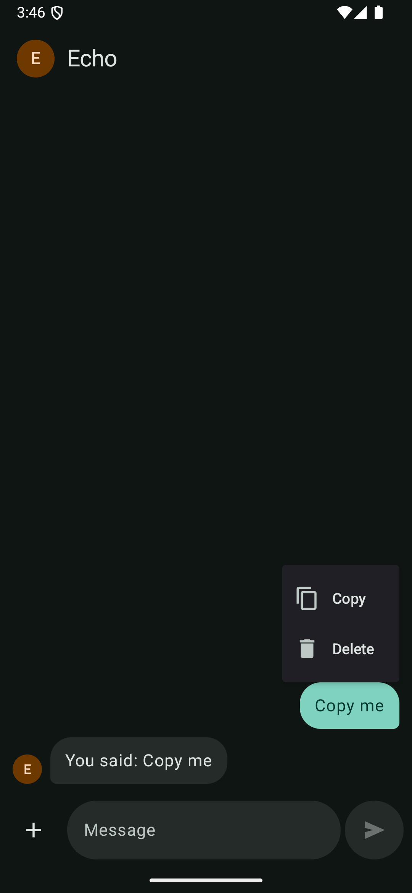 | A long-press opens Copy and Delete at the bubble. |
| ACTION-02 | 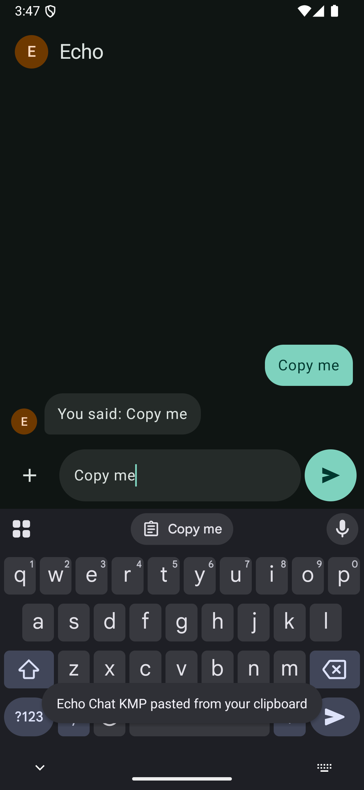 | After Copy, the keyboard offers "Copy me" from the clipboard, and Paste puts it in the input. |
| ACTION-05 | 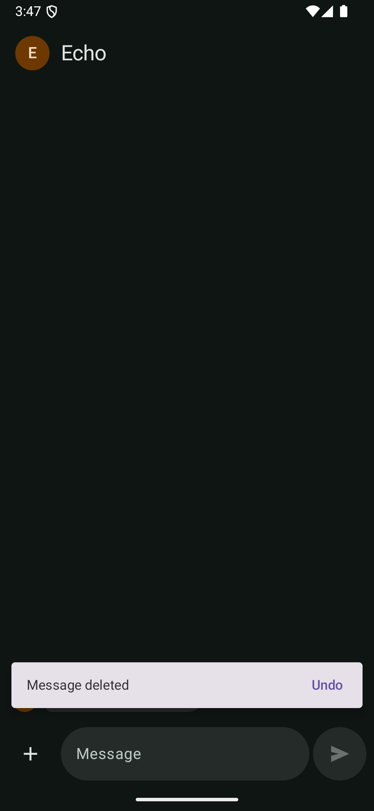 | "Copy me" is gone, with "Message deleted" and Undo. |
| ACTION-05 | 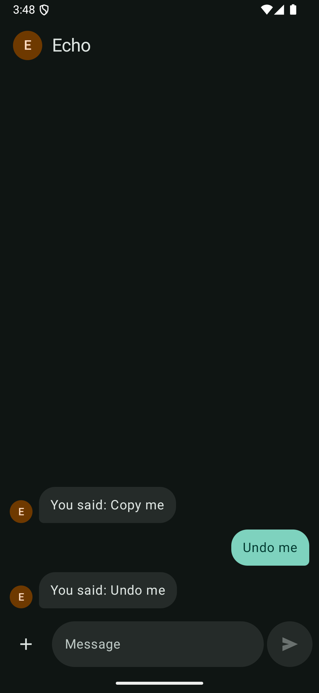 | Undo, tapped within the 4 seconds, puts "Undo me" back in its place, above Echo's reply. |
| ACTION-01 | 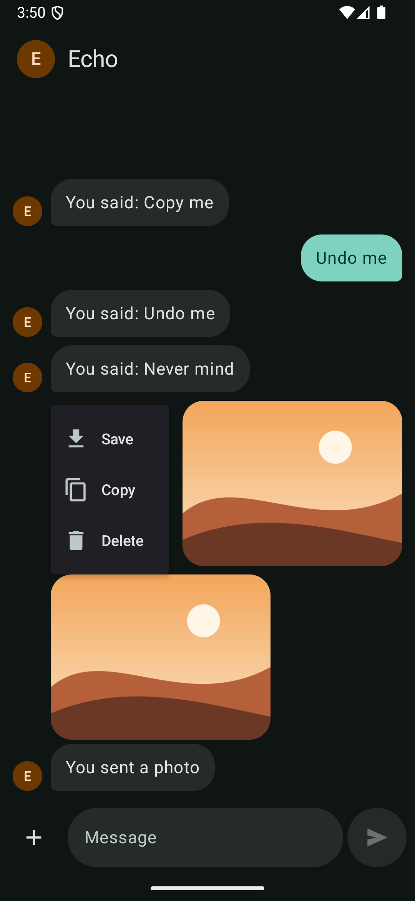 | A long-press on Echo's photo offers Save, Copy and Delete. Above it, "Never mind" was deleted before its reply, and the reply still arrived (ACTION-06). |
| ACTION-04 | 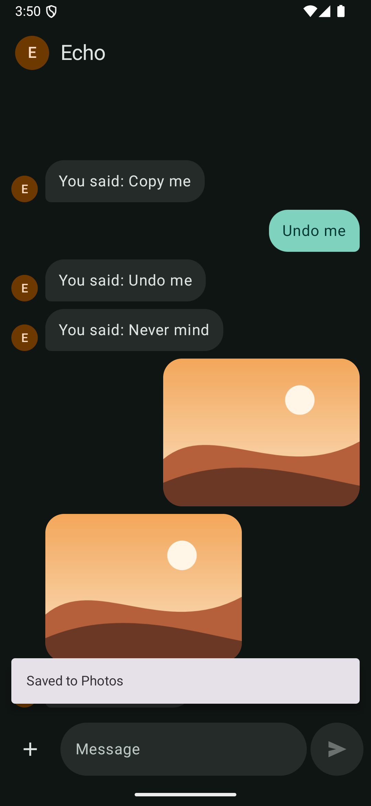 | "Saved to Photos". The media store lists `Echo Chat 1793829016861.jpg` in `Pictures/Echo Chat/`, as `image/jpeg`. |

When I took too long to tap Undo, the offer had gone and the delete stood, as designed.

## Desktop
Windows 11.

| | Screenshot | What it shows |
|---|---|---|
| ACTION-01 | 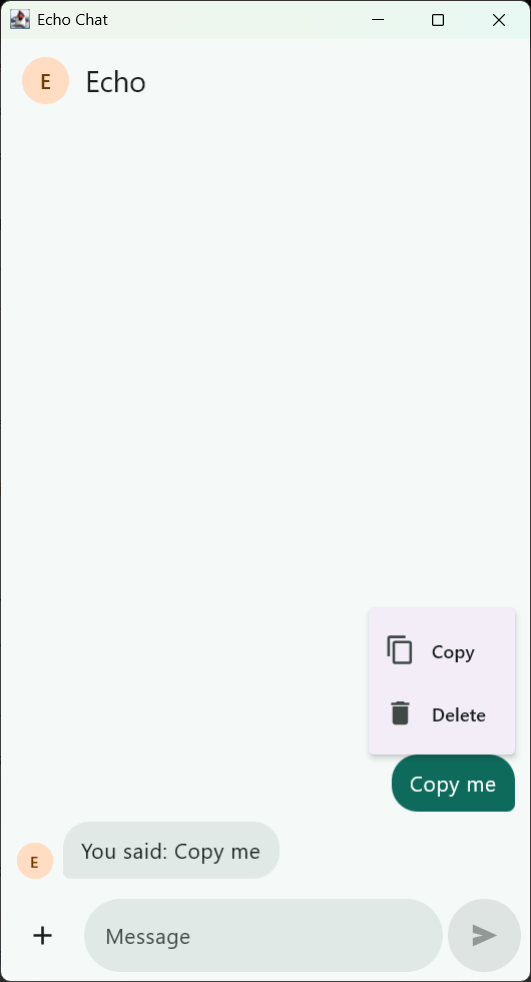 | A right-click opens the same menu at the bubble. |
| ACTION-02 | 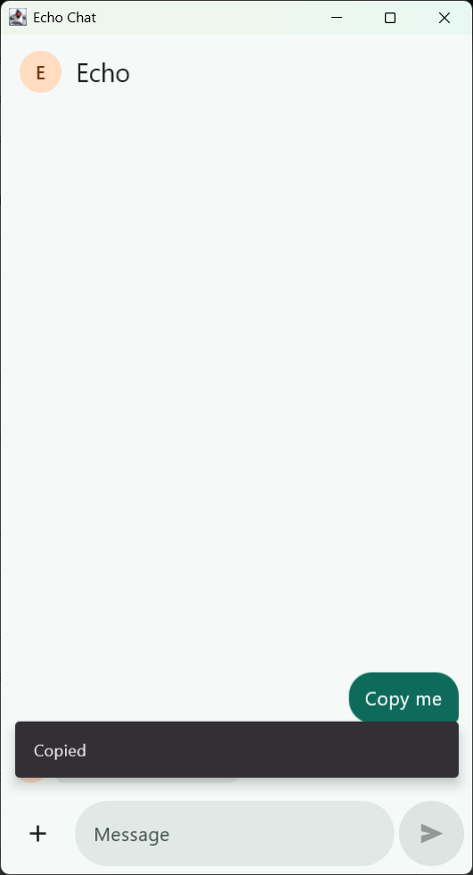 | After Copy, the app says "Copied", and Windows' clipboard holds "Copy me". |
| ACTION-01 | 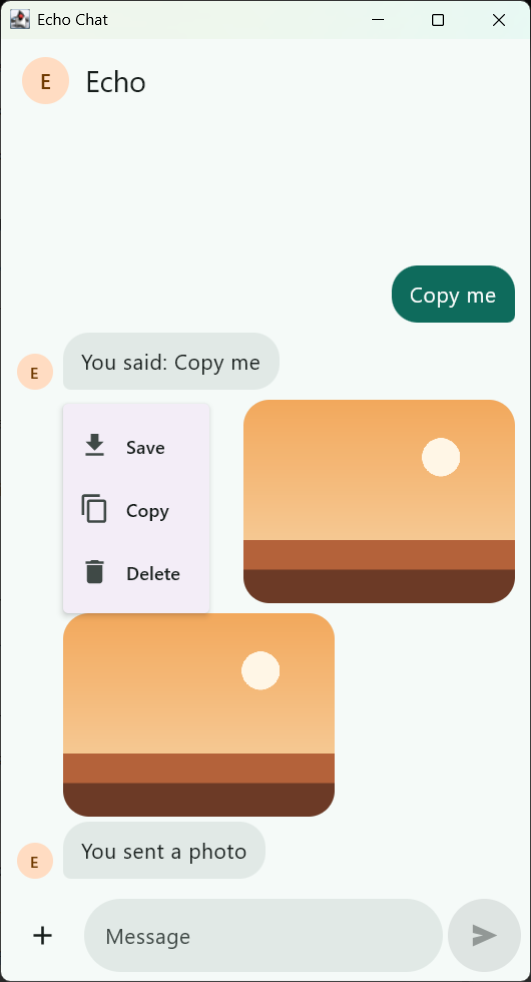 | A right-click on Echo's photo offers Save, Copy and Delete. |

Also checked:
- **Copying a photo (ACTION-03):** Windows' clipboard held the 640 × 480 picture, as PNG and bitmap, and the file, a `.png` from the app's `images` cache.
- **Save (ACTION-04):**
  - The Save As dialog opened at Pictures, suggesting "Echo Chat 1793829190454".
  - Saved into a scratch folder, the copy matched the original byte for byte, and nothing was shown afterwards.
  - Cancel saved nothing and showed nothing.
  - The dialog isn't pictured, because it shows my own Pictures folder.
- **Delete and Undo (ACTION-05):** deleting Echo's photo took its caption with it. Delete then Undo on a reply put it back in its place.

## iOS
"Echo Chat iPhone 18 Pro" simulator, screenshots from the UI tests.

| | Screenshot | What it shows |
|---|---|---|
| ACTION-01 | 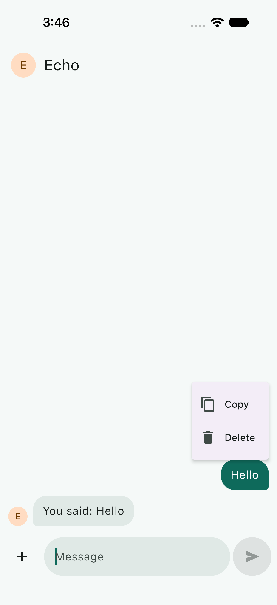 | A long-press opens Copy and Delete at the bubble. |
| ACTION-05 | 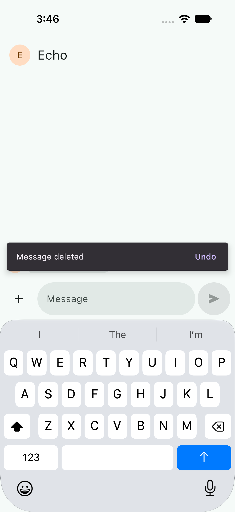 | "Hello" is gone, with "Message deleted" and Undo. The test then taps Undo and finds "Hello" again. |
| ACTION-01 | 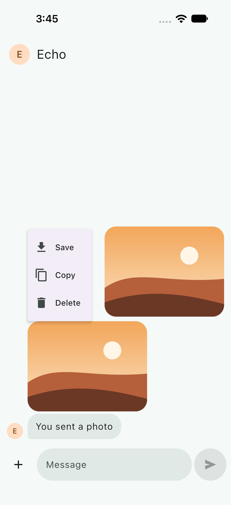 | Save, Copy and Delete for Echo's photo. |
| ACTION-04 | 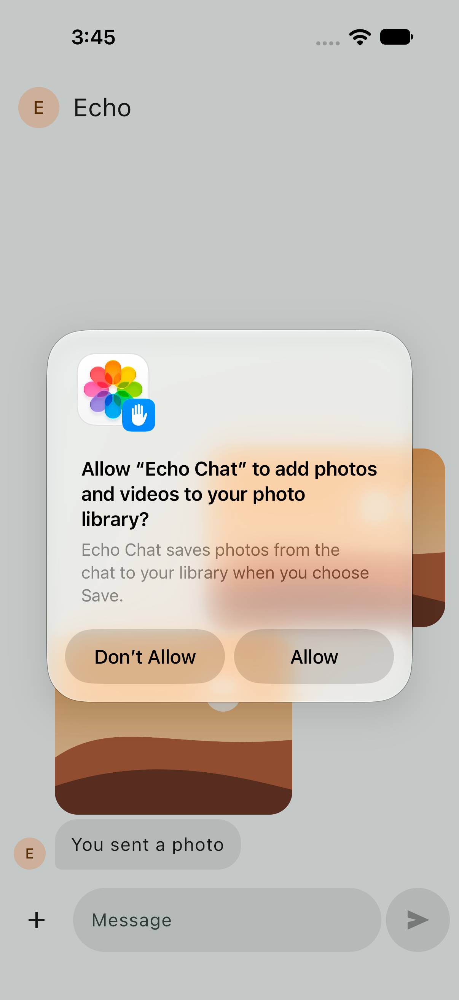 | The first Save asks to add to Photos, with the app's reason. |
| ACTION-04 | 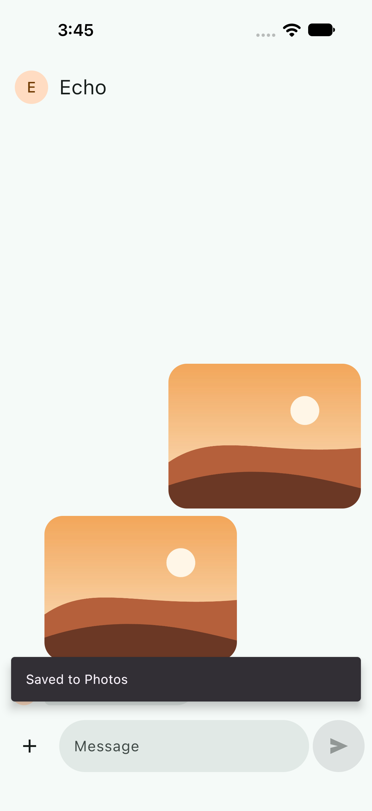 | "Saved to Photos". |

## Not verified here
- **ACTION-06 by hand.** My adb steps each take about 2 seconds, so the 5-second reply was nearly due by the time a message was deleted, and the snackbar covers the typing row. The reply did arrive after the delete. The repository test checks the typing dots and the reply on virtual time.
- **Pasting a photo on Android.** The emulator syncs its clipboard with the computer's as text, as the original found. The device test checks the content link through the real `FileProvider` instead.
- **Copying on iOS by hand.** Text copy is checked by `MessageActionsTest` and photo copy by `PhotoClipTest`, both on the simulator, but nothing was pasted into another app.
- **Save on Android 9 and earlier,** where Save isn't offered. No device that old was used; the screen test checks the menu without Save.
