# Checkpoint 6: keyboard

**Goal:** the original's keyboard fixes on every platform, plus Enter to send on desktop. The attach panel and the keyboard take turns, and Back closes the panel. The keyboard survives a rotation, and Android types in landscape with the keyboard's full-screen box. KEY-01 to KEY-05 pass.

**Date:** 2026-11-04 · **Branch:** `main`

## What changed
| Where | Change |
|---|---|
| `feature:chat` · chat screen | Opening the panel takes the cursor out of the input, and the cursor going back in closes the panel. Back closes the panel first, through Navigation Event's multiplatform back handler. The screen saves whether the keyboard was up and brings the cursor back, at the end of the draft, after Android rebuilds it (D30). |
| `feature:chat` · per platform | `isKeyboardUp()` for each platform. On Android, the input lets a landscape keyboard go full screen. On desktop, Enter sends and Shift+Enter starts a new line (D31). |
| `gradle/libs.versions.toml` | Navigation Event's Compose library, declared at the 1.1.0 already in use. |
| `androidApp` | Device tests for rebuilding the activity while typing and for the full-screen keyboard's request and Send key. |
| `iosApp` | A UI test for the panel and keyboard taking turns, the edge swipe and a rotation. |

## Tests
### `./gradlew allTests`: 85 of 85 pass on Windows, 72 of 72 on the iOS simulator
- **New tests:** 9 on desktop, 6 on iOS:
  - `ChatScreenTest`: KEY-01, KEY-02, and KEY-03 ×4.
  - `EnterToSendTest`: KEY-05 ×3, desktop only.
- **Before the code:**
  - 6 failed for the expected reason: the panel stayed open after tapping the input or Back, and there was no cursor, or none at the end, after a rotation. Enter added a line instead of sending.
  - 3 passed from the start, because that behaviour already existed: no rotation brought back a keyboard I had closed, or a cursor I never placed, and Shift+Enter already added a line.
  - The 76 existing tests passed throughout.

### Android device tests on the S23 (Android 14): 5 of 5 pass
Two are new: `KEY-03_theKeyboardComesBackAfterTheActivityIsRebuiltWhileTyping` and `KEY-04_theKeyboardMayGoFullScreenAndItsSendKeySends`. With the code each one checks stubbed out, both failed for the expected reason. The input had no focus after the rebuild, and the keyboard was still told never to go full screen (`IME_FLAG_NO_FULLSCREEN`).

### iOS UI tests on the simulator: 4 of 4 pass, from a fresh install
`testTheAttachPanelAndTheKeyboardTakeTurns` is new. On iOS it shows the panel and the keyboard taking turns, the swipe in from the edge closing the panel, and the keyboard and draft surviving a turn to landscape and back. It also records the known issue below as an expected failure.

Two things had to be fixed in the test setup on the way:
- **The simulator's keyboard.** The simulator had stopped showing its on-screen keyboard, even for the last commit's code. Turning off its keyboard minimization fixed it (D32).
- **My test's timing.** The new test's first versions tapped while the screen was still turning, and looked for the input by a label it loses once it has text.

## Android
`darkmode35` emulator, Android 15, dark theme.

| | Screenshot | What it shows |
|---|---|---|
| KEY-01 | 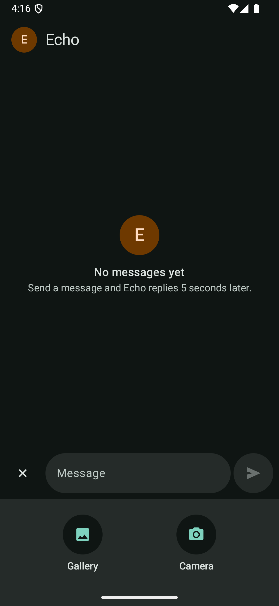 | With the keyboard up, Attach opens the panel and the keyboard goes (`mInputShown=false`). |
| KEY-01 | 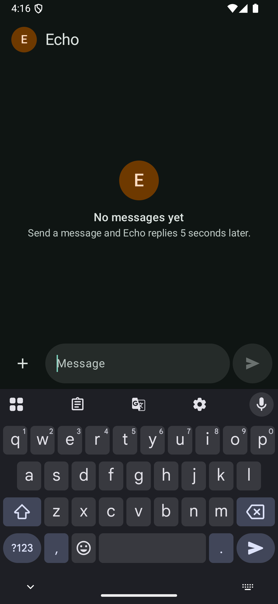 | Tapping the input brings the keyboard back and closes the panel. |
| KEY-02 | 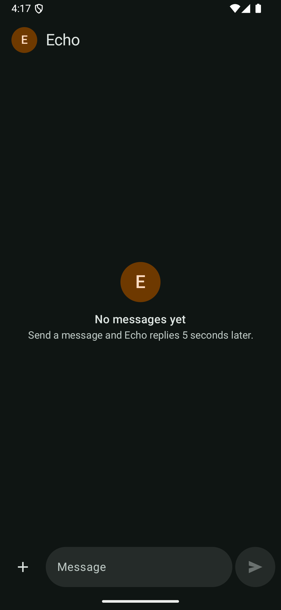 | Back closes the panel and the chat stays. A second Back went to the home screen. |
| KEY-03 | 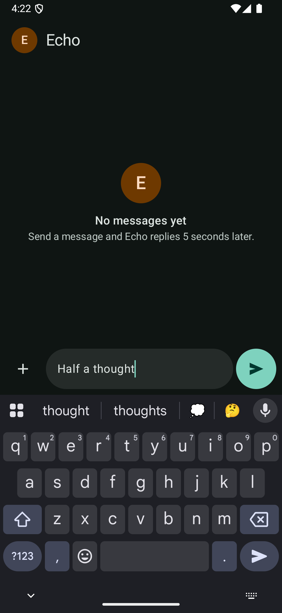 | "Half a thought" typed, keyboard up. |
| KEY-03, KEY-04 | 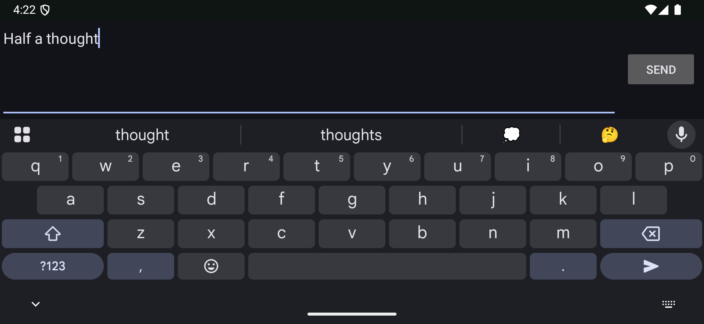 | Turned to landscape: the keyboard came back by itself, full screen (`mIsFullscreen=true`), with the draft and the cursor at its end. |
| KEY-04 | 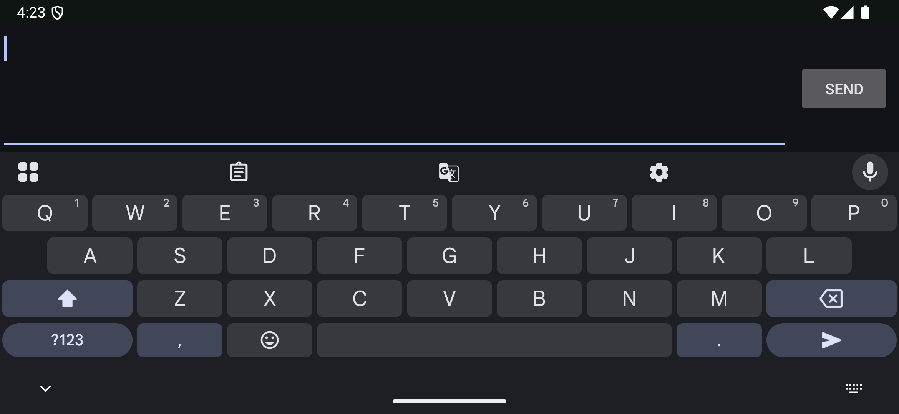 | The box's own SEND sent the message, and the box is empty for the next one. |
| KEY-04 | 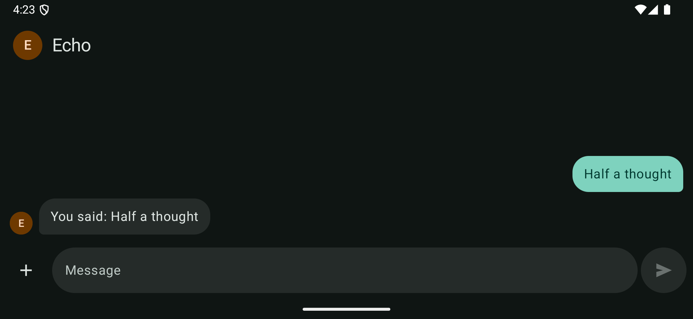 | With the keyboard closed, the chat shows again, with Echo's reply. |
| KEY-03 | 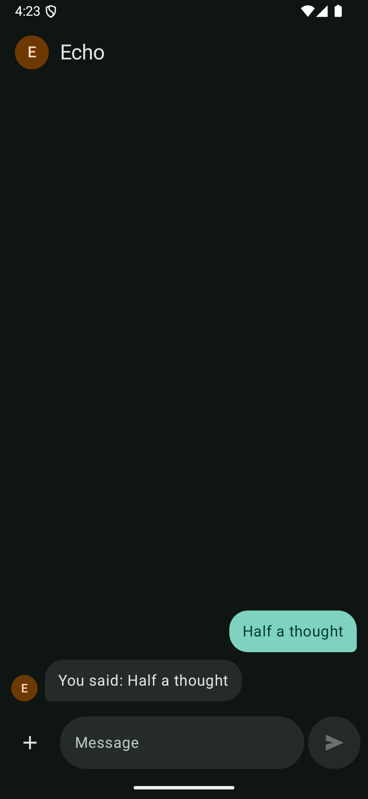 | Turned back to portrait with the keyboard closed: it stays closed. |

## Desktop
Windows 11.

| | Screenshot | What it shows |
|---|---|---|
| KEY-05 | 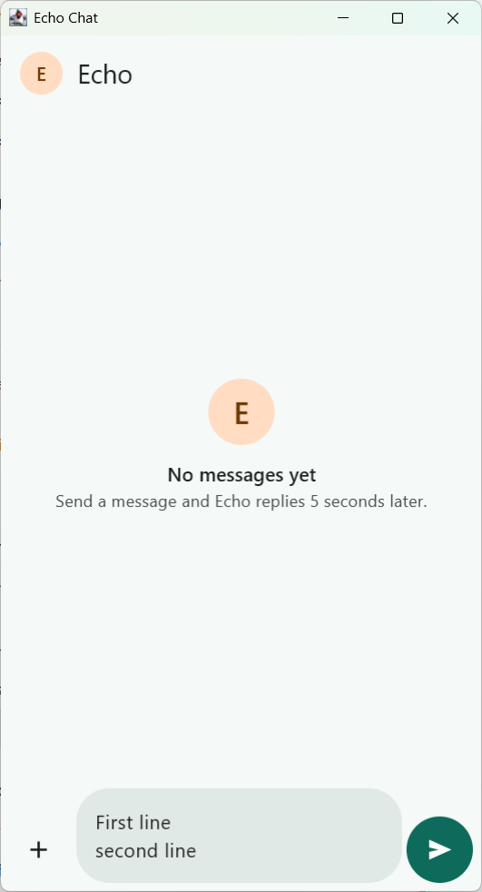 | Shift+Enter starts a new line. |
| KEY-05 | 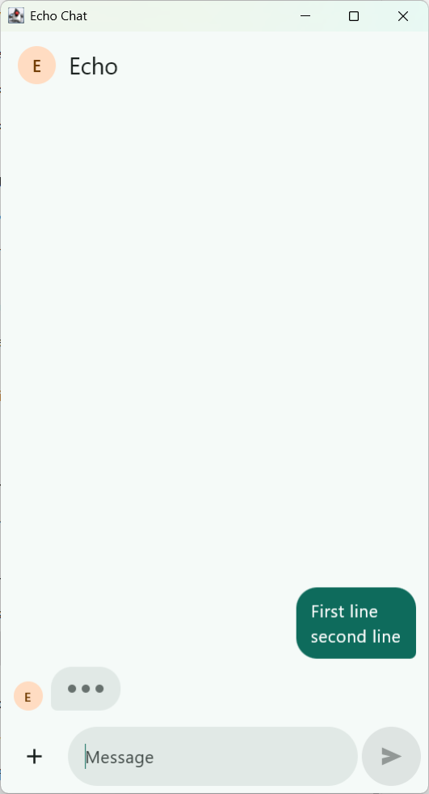 | Enter sends both lines as one message. A second Enter, on the empty input, did nothing. |
| KEY-02 | 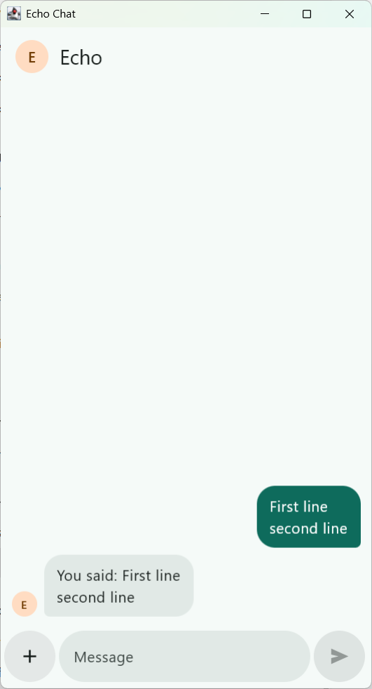 | Esc closes the panel. A second Esc left the window open, since there is nothing to go back to. |

Also checked: with the panel open, clicking the input closed it and put the cursor there (KEY-01).

## iOS
"Echo Chat iPhone 18 Pro" simulator, screenshots from the UI test.

| | Screenshot | What it shows |
|---|---|---|
| KEY-01 | 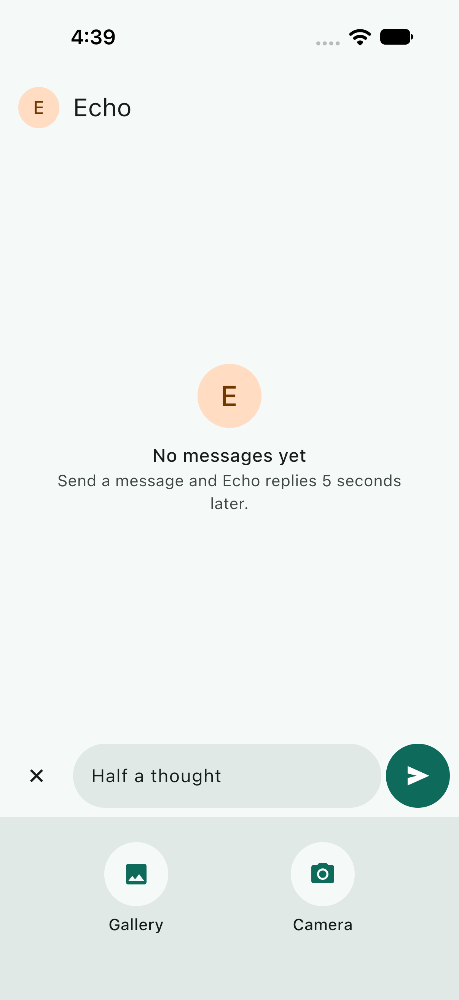 | With the draft typed, Attach opens the panel and the keyboard goes. |
| D33 | 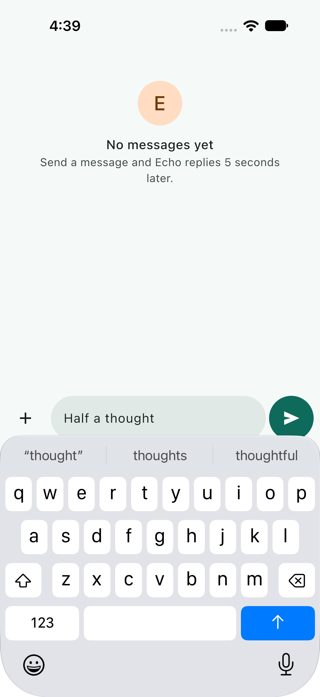 | After landscape and back, the keyboard and the draft are still there, but the chat sits too high and the top bar is off the screen. |

## Known issue
**iOS, rotating with the keyboard up (D33).** Compose Multiplatform 1.12.2 doesn't update the keyboard's inset when the screen turns, and its fallback slides the whole chat up until the keyboard closes. It predates this slice. Turning the slide off left the input behind the keyboard instead, so it stays as Compose has it. The UI test records it, so a Compose release that fixes it will show.

## Not verified here
- **On a real phone's keyboard.** The original found its keyboard problems with Samsung Keyboard on the S23. Here the S23 ran the device tests, and the by-hand checks used the emulator's Gboard.
- **iOS in landscape, pictured.** XCTest's landscape screenshots come out turned and cut off on this simulator, so the test checks the window's shape instead.
- **The iOS edge swipe by hand.** Only the UI test's drag from the screen's edge was used.
