# Checkpoint 7: the web

**Goal:** the same chat in a desktop browser, built from the shared code with Kotlin/Wasm, and published to GitHub Pages. WEB-01 and WEB-02 pass, and the earlier criteria with web notes behave as their notes say.

**Date:** 2026-11-05 · **Branch:** `main`

## What changed
| Where | Change |
|---|---|
| `build-logic` | The web target for every module, with its tests in headless Chrome. `echochat.web.application` for the web app, and `echochat.web.tools` for Node.js and the other tools Kotlin downloads, which run one browser at a time (D38). |
| `settings.gradle.kts` | The download sites for Node.js, Yarn and Binaryen, and the `webApp` module. |
| `gradle/karma.config.d` | Shared browser test settings: longer timeouts, the string files served to the test page, and no Chrome sandbox on CI. |
| `core:data` | `MemoryImageStore`: photos kept in memory, and Save as a download (D37). |
| `core:notifications` | `WebNotificationTray`: the browser's notifications, one per reply, closed when the chat shows. |
| `feature:chat` | `nonMobileMain`, shared by desktop and the web: Enter to send, no camera, no status bar. The web's copy, which converts photos to PNG, its Save, and the permission request on the first send. A refused copy is now caught on every platform. |
| `webApp` | The launcher, its page with the old-browser message, the Echo icon, and the browser's Back button wired to the app's Back (D35). |
| `core:testing` | Test helpers that work in a browser: `loadStrings()`, test photos as browser files, and a clipboard that can refuse. |
| `.github/workflows/web.yml` | Tests on the JVM and in headless Chrome, then publishes to GitHub Pages (D36). |

## Tests
### `./gradlew allTests` on Windows: 77 on the JVM, 90 in headless Chrome, all pass
- **New tests in the browser:** 17.
  - `WebNotificationTrayTest` (NOTIFY-02 to NOTIFY-05).
  - `MemoryImageStoreTest` (PHOTO-01 ×2, ACTION-04 ×2).
  - `PhotoClipTest` (ACTION-03).
  - `BrowserBackTest` (KEY-02 ×4).
  - `WebAppTest` (WEB-01).
  - `EnterToSendTest` (KEY-05 ×3), which now runs on the web as well as desktop.
- **New tests everywhere:** two. `ChatViewModelTest` has the browser's download (ACTION-04), and `MessageActionsTest` a copy the system refuses (ACTION-02).
- **Before the code:**
  - 12 failed for the expected reason. The placeholder store kept nothing, the tray showed nothing, the clipboard got no PNG, the download said nothing, the browser's history got no entry, and the web page showed no chat. The refused-copy test failed with the refusal escaping uncaught.
  - 7 passed from the start. Four were already met by a placeholder that does nothing:
    - showing nothing without permission;
    - reporting a failed download;
    - leaving the page with nothing to close;
    - taking no history entry away when none was added.
  - The other three are the Enter-to-send tests, which moved from desktop with the code they test.
- **The shared tests in a browser** first failed in 26 places, finding no text. In a browser the strings arrive later; see D38.

### On the Mac: 74 iOS shared tests and 4 iOS end-to-end tests pass

### Android device tests on the S23: 5 of 5 pass

## By hand
The release build, served on this PC.

### Chromium
The browser pane in the Claude app.

| | Screenshot | What it shows |
|---|---|---|
| CHAT-04, KEY-05 | 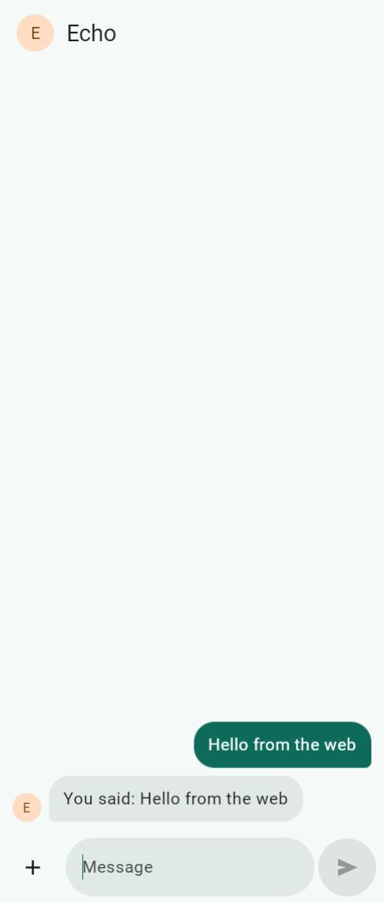 | Enter sent "Hello from the web", and Echo answered 5 seconds later. |
| PHOTO-01, KEY-01 | 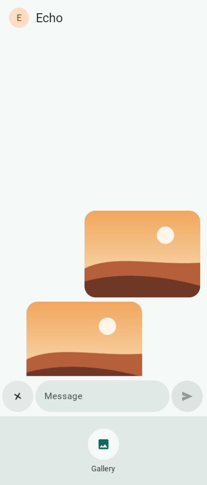 | The panel offers the gallery only. Esc closed it, and so did clicking the input. |
| PHOTO-01 | 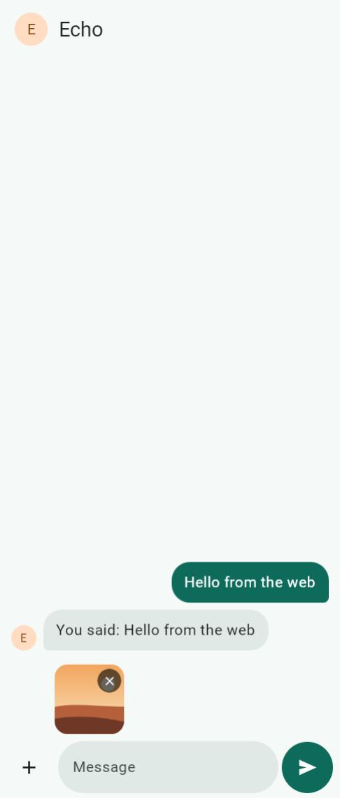 | A picked photo above the input, with its remove button, and Send turned on. |
| PHOTO-03, PHOTO-04, PHOTO-06 | 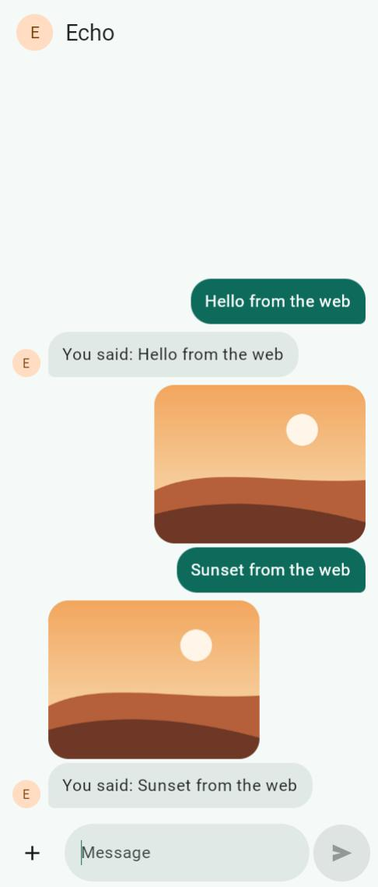 | The photo and its caption, and Echo's reply with the same photo. |
| ACTION-01 | 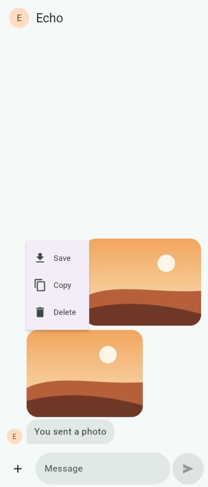 | Right-clicking Echo's photo opens the app's menu, and the browser's own stays away. |
| PHOTO-05, KEY-02 | 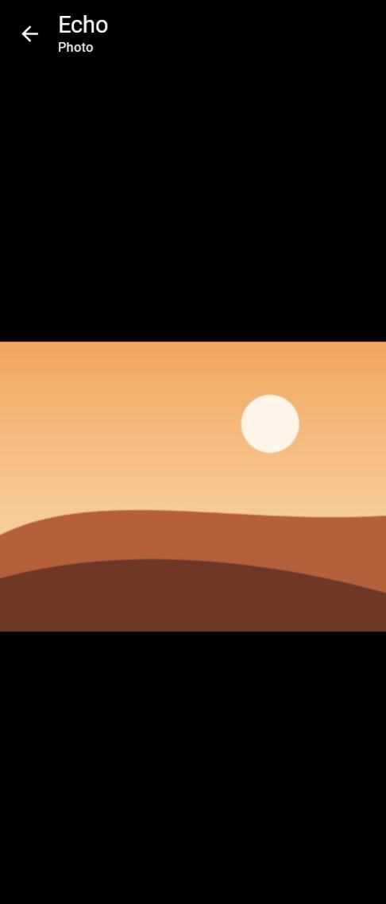 | The photo full screen. The browser's Back closed it and stayed on the page; it closed the attach panel too. |

The pane runs Chromium but blocks notifications and the clipboard, so:
- **The file picker was a stand-in** that handed the app a drawn photo, as the browser's own picker would.
- **ACTION-04:** Save handed the browser a download named "Echo Chat" and the time, and the app said nothing.
- **ACTION-02:** the pane refused the copy, and the chat carried on. This is how the refused-copy bug was found.
- **NOTIFY-01 to NOTIFY-05**, with a stand-in for the browser's Notification API:
  - the first send asked for permission;
  - a reply notified while the photo viewer was open, while the window wasn't focused, and while the tab was hidden;
  - each notification came from "Echo" with the reply;
  - clicking one brought the tab forward and closed the viewer;
  - showing the chat closed them.

### Firefox
Playwright's Firefox 157, headless, using the browser's real file picker.

| | Screenshot | What it shows |
|---|---|---|
| ACTION-01 | 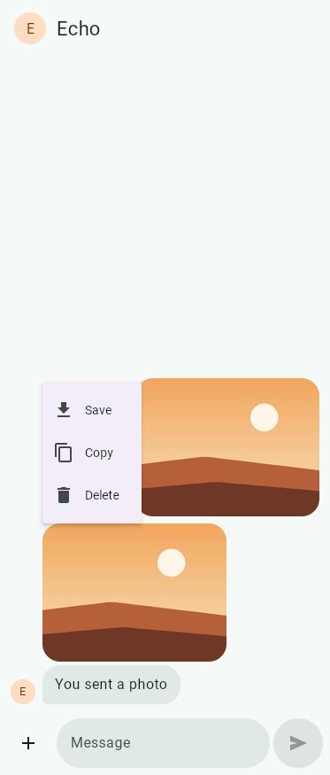 | Right-click opens the app's menu in Firefox too. |
| ACTION-02, ACTION-03 | 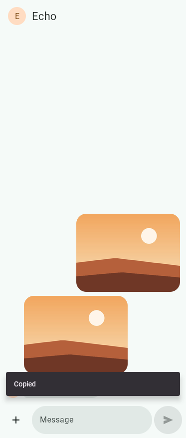 | Firefox accepted the photo's copy, so the app said "Copied". |
| CHAT-04, KEY-05 | 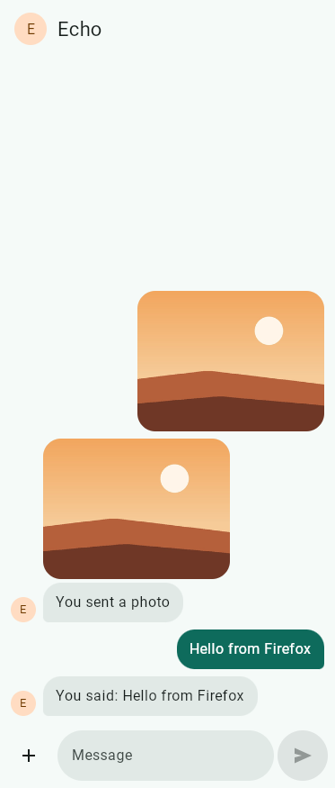 | Enter sent the message, and Echo answered. |

Save downloaded "Echo Chat" and the time as a JPEG. The browser's Back left the viewer and stayed on the page, and Esc closed the panel.

### WebKit
| | Screenshot | What it shows |
|---|---|---|
| WEB-01 | 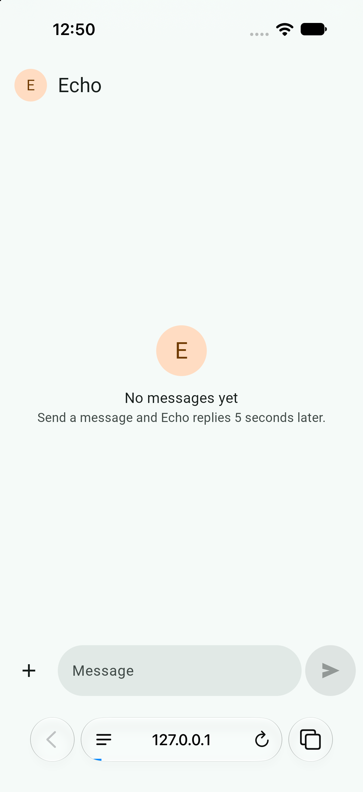 | The chat opens in Safari on the iOS simulator, which uses the same engine as desktop Safari. |

### An older browser
| | Screenshot | What it shows |
|---|---|---|
| WEB-02 | 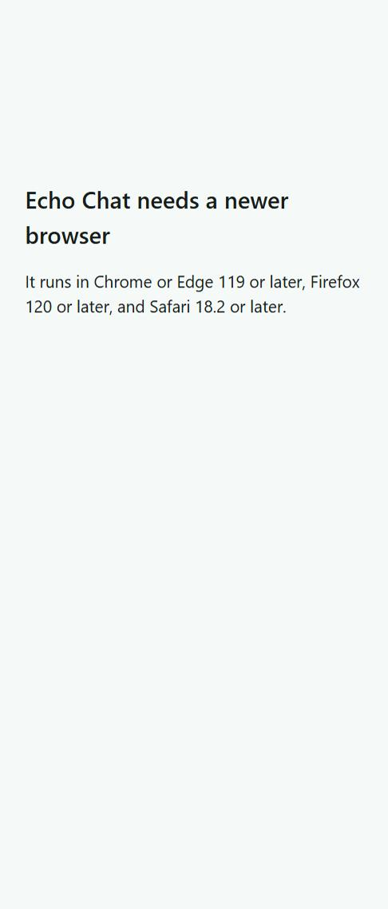 | In a copy of the page whose WebAssembly check fails, the page names the browsers it needs and loads nothing else. |

Edge, headless, ran the app and drew the chat. It ignores the flag that turns off WebAssembly's garbage collection, so it couldn't show this message.

### The live demo, in Chrome
https://memorex386.github.io/echo-chat-kmp/, published by the workflow.

| | What happened |
|---|---|
| WEB-01 | The page loads from GitHub Pages, and a message gets Echo's reply. |
| NOTIFY-05 | The first send asked to show notifications, and I allowed it. |
| NOTIFY-02 | A reply while the chat was on screen didn't notify. |
| NOTIFY-01 | After switching away from the tab, Echo's reply came as a Windows notification from Chrome. |
| NOTIFY-04 | Clicking the notification brought Chrome back to the chat. |
| PHOTO-01 | A JPEG set on Chrome's own file input was attached, sent and echoed. |
| ACTION-01, ACTION-03 | Right-click, then Copy, on Echo's photo: Chrome accepted the PNG, and the app said "Copied". |

## Found and fixed on the way
- **A refused copy stopped the web app.** The browser's refusal escaped uncaught and stopped Compose. The copy catches it now, on every platform, with a test (D37).
- **The browser's right-click menu closed the app's.** The page turns the browser's menu off.
- **A stray scrollbar** on the page, from the page being a pixel or two taller than the window.
- **Stale files.** A plain local server let the browser keep the old `echochat.js`, which loaded the previous build. The local checks used a server that turns caching off. GitHub Pages caches for 10 minutes (D36).

## Not verified here
- **Desktop Safari.** WebKit was checked on the iOS simulator instead.
- **Once:** while the pane was being opened and resized, the app drew itself about 1.3 times too big until the page was reloaded. It didn't happen again.
